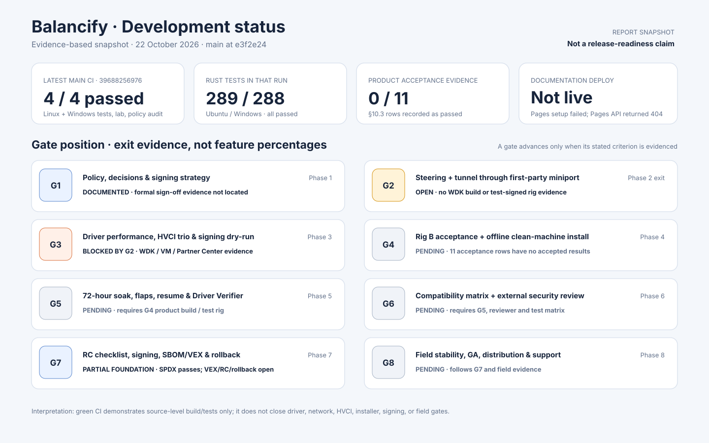
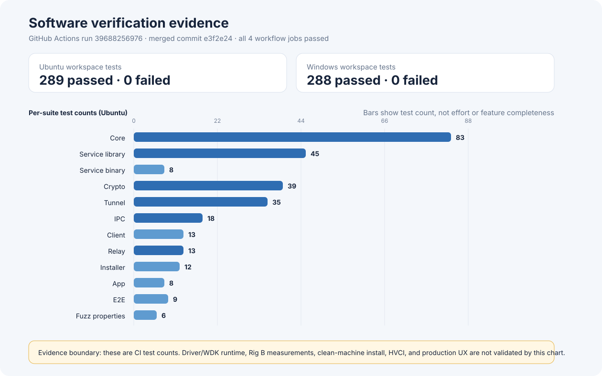
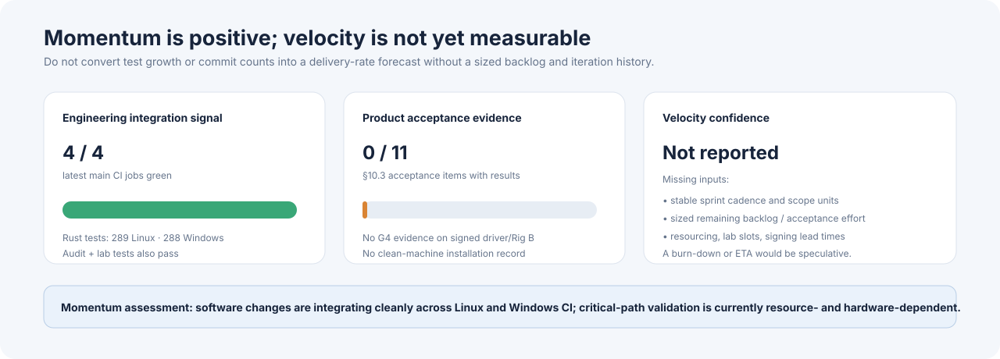
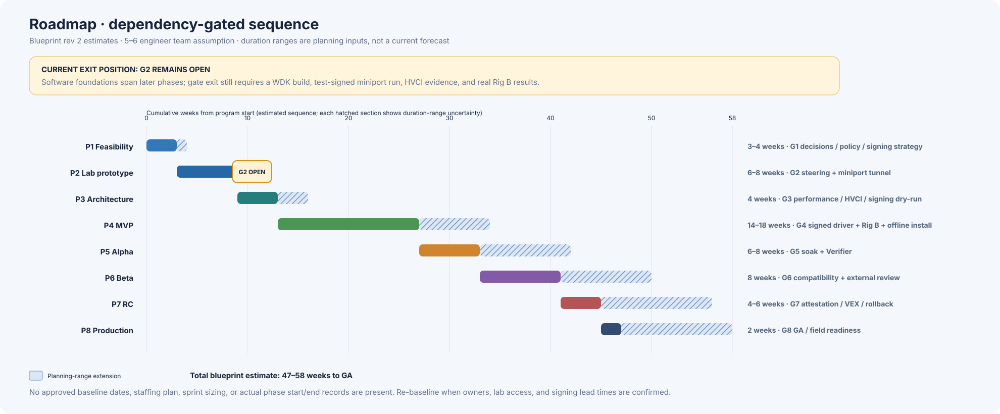
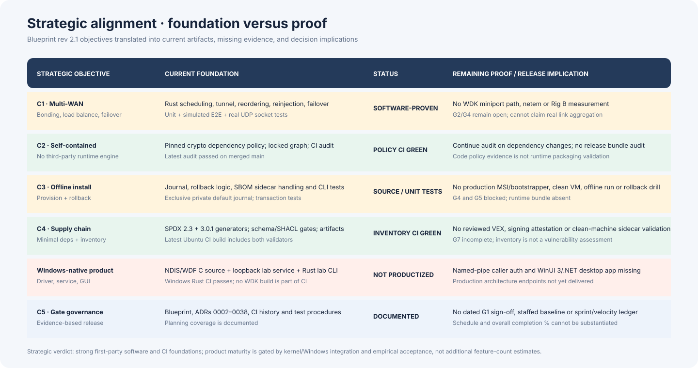

# Balancify — Development Progress Report

**As of:** 22 October 2026 (Asia/Tehran) 
**Repository state:** `main` at merge commit [`4834f18`](https://github.com/eTarikhi/BalanciFy/commit/4834f18); active continuation: `arena/6c62bbae-balancify` 
**Latest verified main CI:** [Run 39694615286](https://github.com/eTarikhi/BalanciFy/actions/runs/39694615286) — all four jobs succeeded. 
**Overall status:** active engineering prototype; **not release-ready**. Gates G2–G8 are not closed; G1 formal sign-off was not found in the repository evidence reviewed for this report.

> **Measurement and evidence rule.** This report separates source/CI evidence from Windows driver execution, network measurements and release validation. Passing Rust tests or a synthetic benchmark does not prove that the product works through an NDIS driver, meets throughput/latency targets, installs offline, or is ready for release. Percent-complete figures and velocity forecasts are omitted where no auditable basis exists.

## Executive snapshot

The project has a substantial first-party Rust software foundation: the merged build passes on Ubuntu and Windows, its latest CI reports 289 and 288 Rust tests respectively, and the dependency/crypto audit and lab-tool checks pass. However, the current service adapter is a loopback TCP lab transport, the app is a Rust CLI rather than the planned WinUI 3 desktop application, and the NDIS driver source has not been built with the WDK or exercised on a Windows VM. The 11 acceptance items listed in the throughput/clean-machine plan have no accepted results.

### Current decision view

| Dimension | Evidence-based position | Decision implication |
|---|---|---|
| Software integration | Latest merged main CI: 4/4 jobs pass; 289 Linux / 288 Windows Rust tests pass | Continue software development; the CI baseline is healthy |
| Driver / OS integration | NDIS/WDF source and portable packet checks exist; no WDK build, test-signed install, Driver Verifier or HVCI VM result | G2 remains open; do not claim an operational miniport |
| Network performance | Software microbenchmarks exist; no real netem S2c or Rig B run | No throughput, added-delay, CPU/Gbit or failover acceptance claim |
| User-facing product | Rust lab CLI and loopback IPC exist; production WinUI/.NET GUI and authenticated named-pipe service transport do not | Production UX and IPC remain unimplemented |
| Installer / release | Journal and rollback logic are tested; no signed offline bundle or clean-machine install record | G4/G5 and release readiness remain open |
| Supply chain | SPDX 2.3 and SPDX 3.0.1 generation/validation are part of CI | Inventory pipeline exists; reviewed VEX, signing, and installer-sidecar validation remain open |
| Documentation deployment | Main run [39694615335](https://github.com/eTarikhi/BalanciFy/actions/runs/39694615335) failed at “Setup Pages”. Pages API GET returned 404; attempt to create the Pages site returned 403, “Resource not accessible by integration” | Portal/workflow are merged in PR #16; site is not live. A repository owner/admin must enable Pages with GitHub Actions as the source, then rerun deployment |

## 1. Retrospective analysis — work completed and evidence

### 1.1 Architecture and governance

The repository contains **37 ADR documents (ADR-0002 through ADR-0038)** and a technical blueprint (rev 2.1) describing a self-contained Windows multi-WAN product: first-party NDIS miniport, first-party datagram tunnel, cooperating relay/server mode, authenticated service/UI IPC, WinUI 3 client, offline installer, supply-chain artifacts and eight go/no-go gates. The blueprint estimates **47–58 weeks to GA for a 5–6 engineer team**. That is a planning estimate, not a current forecast: there is no approved resource-loaded schedule, sprint-size history, or baseline-to-actual report in the repository.

| Milestone | Work delivered | Verification and caveat |
|---|---|---|
| **First-party software foundation** | Control plane, traffic placement and flow classes; health and capacity models; congestion, pacing and DRR; tunnel framing/reorder/reinjection; crypto, identity, replay and rekey; relay/server-mode lab binary. | Cross-platform Rust unit and simulation tests. No real NDIS path or real multi-WAN result. |
| **Protocol/security hardening** | Per-session sequence/retransmission state, authenticated FlowAck/FlowData repair, key storage/DPAPI, pinning, fail-closed client/service transport defaults, replay and source filtering. | Latest CI includes crypto/service/client suites; external review and production service/IPC remain pending. |
| **Diagnostics and lab tooling** | IPC v1, loopback lab service adapter, telemetry and redacted support bundle, ETW event-writing source, netem safety/analyzer tools, software benchmarks. | Contract tests and tool tests pass; no live ETW trace, real netem acceptance, or Rig B evidence. |
| **PR #13 · installer/service hardening** | Transactional SPDX sidecar handling, journal persistence and rollback, fail-closed lab service transport, Home stale-state behavior, loopback-only client policy; source-level driver and SBOM/ETW hardening also landed in earlier merged work. | PR #13 merged 21 Oct 2026; associated CI passed. Driver work remains source-only. |
| **PR #14 · CI and installer hardening** | Ubuntu 24.04 Linux runner pins, Node 24-compatible Pages actions, CI pin contract tests, strict installer CLI parsing, unique exclusively reserved/private default journals, strict UTF-8 IPC decoding. | PR #14 merged as `e3f2e24`; merge CI run 39688256976 passed all four jobs. Pages deployment separately failed at Setup Pages. |

**Legacy visualization warning:** the older PNG dashboards under `docs/assets/progress/` contain unsupported completion/velocity percentages and stale gate labels. This report intentionally does not reuse them; the dated 2026-10-22 SVGs linked below are the current evidence-based visuals.

### 1.2 Technical work by subsystem

| Workstream | Implemented in source / tests | Verification boundary |
|---|---|---|
| **Core policy and scheduling** | Link health/hysteresis, capacity estimation, flow classification/rules, weighted rendezvous placement, flow affinity, per-flow/per-class sessions, bonding gain tracking, MTU/keepalive policy, rate limiting, per-path congestion control, ECN/delay response, pacing and DRR integration. | Unit tests in CI. These tests validate control logic, not live adapter behavior or link performance. |
| **Tunnel and recovery** | First-party versioned frame handling, authenticated AEAD framing, sequence/reorder handling, duplicate/reinjection behavior, per-session sequence/retransmission state, FlowData and selective FlowAck repair, failover logic and sleep/resume state handling. | Unit, end-to-end simulation and fuzz-style tests; a real UDP socket test exists. No driver-path or multi-WAN hardware acceptance. |
| **Crypto and identity** | Noise_IK-style authenticated handshake, ChaCha20-Poly1305, pinned identities, replay protection, rekeying, zeroization and platform-aware key storage (including Windows DPAPI). | Crypto and client/service policy tests in CI; no external security review or production deployment validation. |
| **Service and relay** | Sans-I/O service core, secure lab transport policy, loopback-only TCP IPC adapter, event subscriptions, telemetry snapshots, endpoint filtering and fail-closed handling of invalid identity/pinning configuration. Relay/server-mode lab implementation includes authentication and abuse-control logic. | Service and relay tests pass. The binary still uses simulated uplinks and loopback TCP IPC; it is not a production Windows service or authenticated named-pipe implementation. |
| **IPC and app shell** | IPC v1 request/response/event framing, bounded payloads, strict UTF-8 decoding, client timeout/stale-state behavior, redacted support bundle, Rust CLI modes for Home/Rules/Diagnostics/Tray/Relay/Bundle. | IPC/app tests pass. Production named-pipe ACL/caller authentication, persistent UI state and the WinUI 3/.NET 10 UI are not delivered. |
| **NDIS/WDF driver** | C source for a first-party miniport/control device, raw-IP medium, bounded OIDs, packet-length checks, owned NBL/MDL handling, pause/return lifecycle hardening and restricted control-device SDDL. Portable source-level packet validation is in CI. | **Source-only.** No WDK build, signed driver install, Driver Verifier, HVCI/HLK run, or service-to-miniport data path has been demonstrated. Transmit-ring/product integration remains absent. |
| **Installer** | Lab CLI parsing, dry-run flow, journal JSON serialization/permissions, exclusive reservation of default journal paths, transactional sidecar-copy/rollback logic, collision and failure tests. | Rust tests cover logic only. No production MSI/bootstrapper, bundled runtime, offline VM install/uninstall, power-loss recovery or rollback drill. |
| **Supply chain and CI** | Locked dependency graph and crypto policy audit; SPDX 2.3 and SPDX 3.0.1 inventory generation, validation and CI artifacts; Linux jobs pinned to Ubuntu 24.04; Pages workflow actions updated to exact releases. | Latest main CI is green. This proves source/build/test/policy checks, not driver signing or deployment. No reviewed VEX or release attestation. |
| **Observability and lab tooling** | ETW event-writing source, telemetry and redacted support bundle, netem safety tooling, analysis utilities, software microbenchmarks, HVCI and clean-machine procedures. | No live ETW trace decode, netem measurement, real Rig B measurement, or HVCI/clean-machine procedure execution. |

### 1.3 Current test evidence

The latest merged-main check run publishes the following test counts (zero-test binaries omitted). The one-test difference is in the client suite between operating systems.

| Suite | Ubuntu | Windows |
|---|---:|---:|
| Core | 83 | 83 |
| Service library | 45 | 45 |
| Service binary | 8 | 8 |
| Crypto | 39 | 39 |
| Tunnel | 35 | 35 |
| Relay | 13 | 13 |
| IPC | 18 | 18 |
| Installer | 12 | 12 |
| Client | 13 | 12 |
| App | 8 | 8 |
| End-to-end | 9 | 9 |
| Fuzz/property tests | 6 | 6 |
| **Total** | **289** | **288** |

The same CI run reports success for dependency/crypto policy audit and lab analysis/tool tests. The driver is not built in this workflow; see `.github/workflows/ci.yml` and `docs/phase2/lab-progress.md`.

### 1.4 Momentum and velocity

**Software integration remains green:** PR #16 (the static portal and narrowed Pages artifact) merged as `4834f18`; main CI run `39694615286` passed all four jobs, including Ubuntu and Windows workspace tests. The Pages workflow now packages only the portal, but deployment is blocked because the repository Pages site is not enabled and this connection lacks permission to create it (API POST returned 403).

**Velocity is not quantified.** The repository does not contain a consistent sprint cadence, estimated story-point history, stable backlog denominator, staffing record, or approved phase dates. Commit counts and test counts are not substitutes for scope-normalized throughput. Consequently this report provides no velocity slope, burn-down percentage, or completion percentage. A measured velocity/burn-down chart should be added only after agreeing a work-unit scheme and maintaining dated sprint snapshots.

## 2. Prospective planning — dependencies and deliverables

### 2.1 Dependency-aware roadmap

The diagram transcribes the blueprint’s original phase-duration ranges. It does not locate “today” on those ranges: actual resource-loaded start/end dates are absent, and software work has advanced ahead of some gate evidence. Treat the ranges as planning inputs to re-baseline, not commitments.

### 2.2 Proposed deliverables and sequencing

The horizons below are **proposed planning windows after the required resources are assigned**, not booked dates. The existing blueprint estimates remain the only documented duration baseline.

| Horizon / phase | Deliverable | Dependencies and exit evidence | Lead / external prerequisite |
|---|---|---|---|
| **T0–2 weeks: unblock G2** | Build the miniport with the supported WDK (x64 first; ARM64 next), resolve build/lifecycle issues, set up a disposable test-signed Windows VM, and execute a minimal driver load/packet-path smoke test. | WDK and Visual Studio; driver source review; test VM with Secure Boot/vTPM as applicable. G2 requires steering evidence across ≥3 adapter classes plus tunnel operation through the first-party miniport; the current socket-only tests do not satisfy this. | Driver engineer; Windows/WDK lab access; test-signing setup. |
| **After G2: Phase 3 / G3** | Benchmark driver packet-path latency/CPU/memory; execute Driver Verifier with code-integrity, HLK HVCI readiness, and VBS/Memory Integrity VM tests; perform Partner Center/attestation dry run; finalize IPC contract and GUI wireframes. | G2 closed; WDK-built/test-signed driver; instrumented Windows VM; Partner Center slot and signing strategy. G3 exits only with measurement, HVCI and signing evidence. | Driver/performance/release engineering; signing enrollment and external service lead times. |
| **After G3: Phase 4 / G4** | Complete service-to-adapter packet path, production authenticated named-pipe IPC, WinUI 3/.NET 10 shell, self-host/relay packaging, offline installer/bootstrapper, and real Rig B acceptance set. | G3; signed driver path; real wired/Wi-Fi/cellular test rig and relay; 10-repeat data collection; installer runtime bundle and acceptance definitions. G4 includes 11 planned acceptance items in `throughput-rows.md` / `clean-machine-test.md`; none has recorded passing evidence at this snapshot. | Systems, UI and packaging engineers; Rig B; clean Windows VM farm. |
| **Phase 5 / G5 (blueprint 6–8 weeks)** | Internal alpha, 72-hour soak, random link flaps, 100 sleep/resume cycles, Driver Verifier, crash/dump path, clean install/uninstall. | G4; test-signed/signed driver; stable release candidate; offline x64/ARM64 VMs with HVCI on/off. | Test/support engineering; soak rig and VM matrix. |
| **Phase 6 / G6 (blueprint 8 weeks)** | Compatibility matrix for VPN/AV/Hyper-V/WSL2/Memory Integrity; external security review, including driver and fuzz results; docs site live. | G5; supported Windows images; reviewer booking; Pages configuration. | Security reviewer and compatibility lab. |
| **Phase 7 / G7 (blueprint 4–6 weeks)** | RC, final attestation, signed installer/update feed, reviewed VEX, SBOM release validation, service+driver rollback drill and signed checklist. | G6; signing submission queue; current advisory data and reviewed impact analysis; complete rollback implementation. | Release/security engineering; Partner Center/attestation. |
| **Phase 8 / G8 (blueprint 2 weeks + field observation)** | GA distribution (download/winget), support runbooks, status page and opt-in telemetry; observe initial field stability. | G7; distribution validation, operational owner and support readiness. | Release/operations/support. |

**Near-term critical path:** WDK build → test-signed miniport smoke test → G2 closure → G3 performance/HVCI/signing → G4 real adapter/Rig B/clean install. GUI, installer bundling and VEX work can progress in parallel, but they cannot substitute for these gates.

### 2.3 Risks and management actions

| Risk | Impact | Current signal | Mitigation / decision needed |
|---|---|---|---|
| Driver source fails WDK build or lifecycle checks | Critical-path schedule and system stability | No WDK build/Verifier run in evidence set | Assign NDIS/WDK owner and lab; make a Windows build a tracked gate artifact. |
| Product performance differs from software simulation | Core value proposition unproven | No Rig B or real netem data; benchmark is CPU-side | Collect raw 10-run data only through the driver and relay; retain baselines and instrumentation. |
| Production IPC/GUI remain absent | Product not user-operable | Loopback TCP lab adapter and CLI only | Define authenticated named-pipe ACL/caller identity, then implement and test against the service. |
| Installer is not a distributable product | Cannot validate offline install, recovery or uninstall | Journal logic only; no signed bundle/clean VM run | Assign packaging engineer; create clean VM matrix and failure-injection rollback test. |
| Signing/HVCI/VEX/external review lead time | Release gate delay | Procedures and SBOM inventory exist; executions/review not recorded | Start signing coordination and reviewer booking before G3/G6; record external dependencies and dates. |
| Pages deployment cannot start | No public docs/distribution site | Main run `39694615335` failed at `Setup Pages`; Pages API GET returned 404 and create returned 403 `Resource not accessible by integration` | Repository owner/admin must enable Pages using GitHub Actions as the source; rerun the workflow and verify the published URL. |
| Schedule/velocity estimates could mislead stakeholders | Poor forecasting | No sized backlog or resource-loaded plan | Establish owners, work-unit sizing, iteration cadence, planned-vs-actual dates before publishing burndown/ETA. |

## 3. Strategic alignment — position relative to the product strategy

The strategy is **aligned at the architecture and source-foundation level**, but not yet at the end-to-end product-evidence level:

1. **C1 — multi-WAN aggregation:** core scheduling, tunnel, recovery and simulated end-to-end behavior exist; first-party miniport integration and real acceptance are absent. This is the principal proof gap.
2. **C2 — self-contained runtime:** dependency policy and audit are implemented and pass CI. A real bundle-content audit remains necessary at release.
3. **C3 — offline provisioning:** journal/rollback/sidecar source logic has tests, but no signed offline installer or clean-machine trial exists.
4. **C4 — minimal/supply-chain dependencies:** lockfile audit and SPDX 2.3/3.0.1 CI pipeline exist. Reviewed VEX and final release attestation do not.
5. **C5 — staged execution and governance:** blueprint, ADRs and gate procedures exist, but formal G1 sign-off, staffed owners, schedule baselines and exit artifacts are not evidenced in this snapshot.

### Gate register

| Gate | Required exit criterion (short form) | Status as of report | Evidence needed to close |
|---|---|---|---|
| **G1** | Decisions, policy, signing strategy and enrollment | **Unverified** | Store/review formal decision and enrollment/signing evidence; do not infer pass from ADRs alone. |
| **G2** | Steering plus first-party tunnel through test-signed miniport | **Open** | ≥3 adapter classes; WDK build; end-to-end miniport/driver test on a rig. |
| **G3** | Driver performance, HVCI trio, signing dry-run | **Blocked by G2** | Packet-path metrics; Verifier/HLK/VBS-MI results; accepted signing dry-run. |
| **G4** | Real §10.3 acceptance and clean-machine offline provisioning | **Pending** | 11 acceptance items; real rig, signed driver, offline install/uninstall and rollback evidence. |
| **G5** | Soak and Verifier clean | **Pending** | 72-hour run, flaps/resume matrix, no crashes/leaks, clean install matrix. |
| **G6** | External review and compatibility matrix | **Pending** | Review report with no unresolved high-severity issue; matrix across supported configurations. |
| **G7** | RC checklist, attestation, SBOM/VEX and rollback proof | **Partial foundations only** | Final signing/attestation, reviewed VEX, release SBOM validation and rollback drill. |
| **G8** | Field stability and production operations | **Pending** | GA distribution, support/status operations and field observation. |

### Strategic conclusion

Balancify has a credible, testable first-party software base and healthy cross-platform CI, but its strategic differentiator—usable, reliable aggregation through its own signed Windows driver—has not crossed the hardware-integration gate. The project trajectory is therefore **software-foundation complete enough to justify the next validation investment, but product readiness remains contingent on G2–G4 evidence**. Adding more software-only feature counts will not reduce the main risk as efficiently as obtaining a WDK build, test-signed VM and Rig B access.

## Sources, definitions and reproducibility

- Latest merged CI/check summaries: [run 39694615286](https://github.com/eTarikhi/BalanciFy/actions/runs/39694615286); PR #16 merged as `4834f18`.
- Pages deployment failure: [run 39694615335](https://github.com/eTarikhi/BalanciFy/actions/runs/39694615335); failed at `Setup Pages`. On 2026-10-22, Pages API GET returned 404 and create returned 403 `Resource not accessible by integration`. The portal and artifact workflow are merged, but an owner/admin must enable Pages before deployment can be verified.
- Product gates and 47–58 week phase estimate: `docs/technical-blueprint.md`, especially §11.1–§11.3. Estimates assume a 5–6 engineer team and require re-baselining.
- Demonstrated behavior and limitations: `docs/phase2/lab-progress.md`.
- Proposed empirical acceptance and methodology: `docs/phase2/throughput-rows.md` and `docs/phase2/clean-machine-test.md`.
- Driver/HVCI status and procedure: `docs/phase2/hvci-readiness.md`, `driver/README.md`, `driver/src/`.
- Dependency/inventory and CI definitions: `.github/workflows/ci.yml`, `tools/ci/`, `Cargo.lock`.
- Test counts above are transcribed from the merged commit's GitHub Actions check summaries, not locally inferred. All strategic status labels are evidence labels, not percentage-completion estimates.
