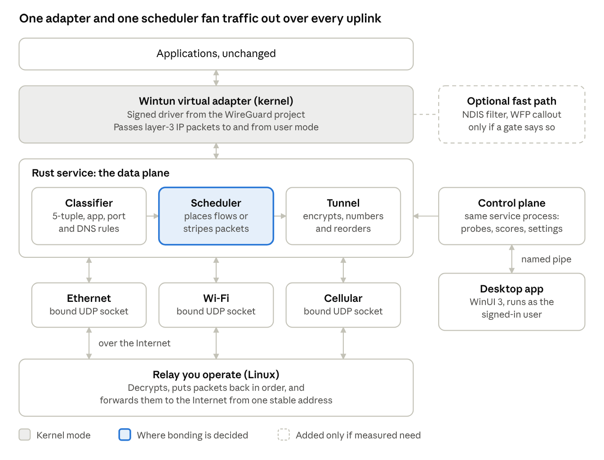
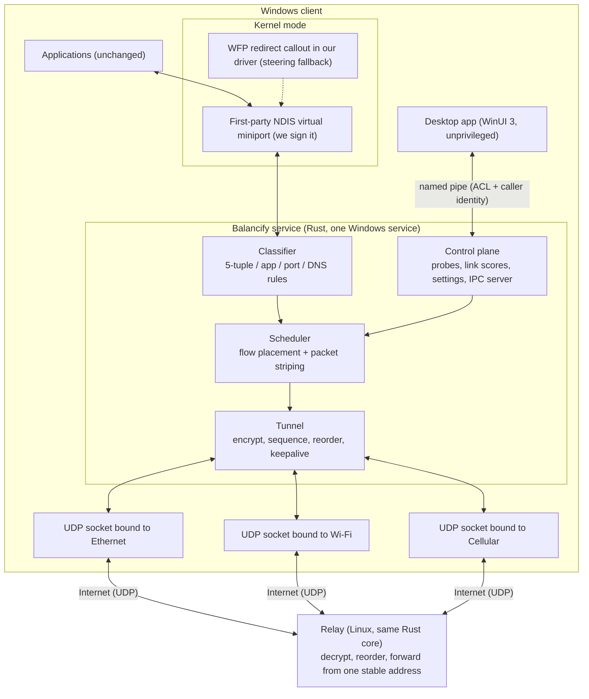
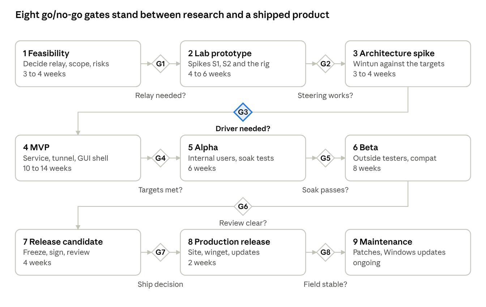

# Balancify — Windows Multi-WAN Aggregation: Technical Blueprint

**Document type:** Engineering decision document (architecture, stack, roadmap, execution plan)
**Version:** 1.0 · **Date:** 2026-10-16 · **Status:** For architecture review
**Scope:** Windows-native application that aggregates Wi-Fi, Ethernet and cellular uplinks behind a single virtual network interface, with load balancing, bonding and seamless failover, a modern GUI, and a professional documentation/distribution web presence.
**Companion inputs:** `SKILL.md` (method and quality bar), `report-outline.md` (skeleton), `Windows Multi-WAN Aggregation Blueprint.docx` (source blueprint, rev. 20). This report follows the outline and extends it with a dedicated UX/web-presence section (§8).

> **Reading guide.** Everything numeric in §10 is a **proposed acceptance criterion**, not a measurement — nothing in this document has been benchmarked yet. Scores in §3 are **engineering judgments** derived from protocol and platform design, on a defined 1–5 scale. Claims that depend on current platform policy, signing rules or framework versions are cited in §15 with access dates; anything seen only as a secondary report is flagged *unconfirmed*.

---

## 1. Executive Summary and Recommendation

### 1.1 The recommendation in one paragraph

Build **Balancify** as a **fully self-contained product** (§4.8 dependency policy rev 2): a **user-mode Rust service fronted by a first-party NDIS virtual miniport that we sign ourselves**, speaking a **first-party encrypted dual-lane tunnel** (datagram lane primary; optional vendored MPTCP lane for standard interop) to a **cooperating endpoint embedded in the same binary as a server mode** — deployed in our cloud, on the user's own VPS/NAS, or on the LAN — with a **WinUI 3 (.NET 10) desktop client** over authenticated named-pipe IPC, and a **static documentation/distribution site** fed by the release pipeline. Ship **per-flow load balancing first**, add **packet-level striping** for flow classes where lab measurement shows a gain. Because the product carries every feature internally, the **in-house driver and its WHCP/HVCI signing calendar are on the critical path from Phase 2**; gate **G3** (§11 rev 2) validates the driver's performance, memory-integrity readiness and signing dry-run instead of deciding whether a driver is needed.

### 1.2 Why this shape

1. **Load balancing is easy; bonding is not.** Distributing independent flows across uplinks needs no server and no driver. Making *one* TCP flow exceed the capacity of its best single uplink requires either a cooperating remote endpoint (relay) that re-sequences packets, or an end-to-end multipath transport. Windows ships neither: it has no Multipath TCP implementation [S21, unconfirmed secondary], and multipath QUIC was still an Internet-Draft in the RFC Editor queue as of 2026-10-16 [S11]. Therefore single-flow bandwidth aggregation ⇒ relay. This is the single most consequential architectural fact in the project.
2. **WFP and NDIS are interception points, not bonding engines.** A WFP callout driver inspects, modifies and reinjects traffic at TCP/IP layers [S1]; an NDIS lightweight filter (LWF) driver sits between a miniport and the protocol drivers [S2]. Neither schedules packets across uplinks, reorders them, or tunnels them. Choosing a driver first buys signing burden and crash risk before buying capability.
3. **Kernel code is the expensive part — and by directive (rev 2) it is ours.** It brings Microsoft driver signing (attestation or HLK/WHCP), Memory Integrity / HVCI readiness testing, SBOM+VEX paperwork from March 2027 for new Windows builds [S13], and whole-machine crash liability. Rev 1 deferred this behind gate G3 using Wintun [S4]; rev 2's self-contained policy (§4.8) excludes third-party kernel binaries, so the miniport, its signing and its HVCI validation join the critical path from Phase 2 — bought with earlier risk retirement and full control of the update path.
4. **Least-privileged viable design.** The GUI runs unprivileged; one Windows service holds the packet path; the only local entry point is an ACL-protected named pipe; the only Internet-reachable component is the relay.

### 1.3 Major trade-offs accepted

| Trade-off | Accepted cost | Rejected alternative and why |
|---|---|---|
| Relay-operated bonding | Egress bandwidth cost, relay placement/latency, availability and abuse-prevention ops | "Bonding with no server" is physically unachievable for single-flow throughput on Windows today (§3) |
| User-mode packet path over a **first-party miniport** (rev 2) | Driver development, WHCP signing and HVCI validation on the critical path (≈ +7 wks to GA vs rev 1) | Bundling a third-party TUN (Wintun): excluded by the dependency policy (§4.8); survives only as the §11.2 time-boxed exception |
| Own tunnel protocol (UDP + Noise-style handshake + sequence/path headers) | We own reordering, congestion and crypto-engineering burden | TCP encapsulation (TCP-over-TCP meltdown); waiting for multipath QUIC RFC + ecosystem adoption |
| Rust for data plane | Most Windows networking samples are C; porting effort if a driver is later needed | C++ for everything: memory-safety risk in code that parses untrusted packets |
| WinUI 3 / .NET 10 for GUI | Managed runtime in the shell; WinUI maturity gaps | WPF (older visual language), web-view shell (two rendering stacks, weaker native tray/a11y) |

### 1.4 Hardest technical risks (full register in §13)

1. **Relay economics and geography** — bonding gain can be eaten by relay RTT and egress cost. *Mitigation:* cost/RTT model for two candidate regions in Phase 1; gate G1.
2. **Uplink steering reliability** — can user-mode sockets actually be pinned to a chosen uplink on Windows 11 when the routing table prefers another? *Mitigation:* Spike S1 in week 1–4; gate G2.
3. **Heterogeneous links** (cellular vs Wi-Fi delay gaps) causing reordering and head-of-line stalls in bond mode. *Mitigation:* emulated-link rig (netem), reorder-buffer tuning, flow-level fallback always present; gate G4.
4. **In-house miniport performance / HVCI readiness** (we now own the packet path rev 2 removed from Wintun). *Mitigation:* Spike S2b + G3 benchmark + HVCI trio; optimization round budgeted.
5. **Signing/distribution calendar for our own driver** (attestation limits, HLK effort, SBOM/VEX from 03/2027, Memory Integrity auto-enablement from Oct 2026). *Mitigation:* enrolment + EV ordered in Phase 1; dry-run at G3; final at G7; §11.2 exception policy as schedule rescue.
6. **Coexistence** with VPN clients, security suites, Hyper-V/WSL2 and Memory Integrity (now including *our* driver in the matrix). *Mitigation:* compatibility matrix from Phase 2, repeated every milestone; gate G6.

### 1.5 Proof-of-concept strategy (three steps, cheapest first)

1. **PoC-1 (no driver, no relay):** service balances flows across uplinks using source-address/interface binding; GUI shell shows live per-uplink telemetry. Validates steering + UX skeleton.
2. **PoC-2 (embedded endpoint):** first-party NDIS miniport skeleton + first-party encrypted datagram tunnel to the **in-binary server mode** across two real links; measures end-to-end throughput, added latency, failover.
3. **PoC-3 (decision experiment):** instrumented packet-path benchmark of the in-house miniport (latency, CPU/Gbit/s, working set) plus the HVCI readiness trio against the proposed targets → **go/no-go on shipping the driver at GA versus invoking the §11.2 exception**.

---

## 2. Requirements, Assumptions, and Non-Goals

### 2.1 Requirements as read from the request

| # | Stated requirement | Engineering reading | Remote server needed? |
|---|---|---|---|
| R1 | Windows-native, low latency, minimal resource overhead | Native user-mode service first; kernel code only behind measured gates; overhead budgets defined in §10 | No |
| R2 | Kernel-level integration addressed (WFP / NDIS) | WFP/NDIS evaluated precisely (§5); used only where a demonstrated need exists (classification/redirect, optional fast path) | No |
| R3 | Robust load balancing for traffic distribution | Per-flow (5-tuple + app/port/DNS rules) distribution with weighted rendezvous hashing (§6) | No |
| R4 | Connection bonding for bandwidth aggregation | Packet-level striping with sequence numbers and relay-side reorder buffer, inside an encrypted tunnel (§6) | **Yes** |
| R5 | Seamless failover | Tunnel outlives any single uplink; health state machine with hysteresis; sessions on surviving paths continue (§6) | Yes (for bonded/tunneled traffic) |
| R6 | Modern, intuitive, highly responsive GUI | WinUI 3 desktop client, thin reactive view of service state, 1 Hz telemetry, tray flyout, accessibility (§8) | No |
| R7 | Professional web presence: docs + distribution | Static docs site from in-repo Markdown; signed installers, checksums, winget manifest; trust signals (§8) | No |

### 2.2 Target platform and environments

- **OS:** Windows 11 24H2/25H2+ on **x64 and ARM64** primary; Windows 10 22H2 best-effort (assumption A1 — open decision D4).
- **Uplinks:** Wi-Fi (802.11ac/ax), wired Ethernet (1/2.5 Gbit/s), USB/WWAN cellular (LTE/5G); later: USB tethering, satellite/LEO terminals as generic IP uplinks.
- **Traffic:** TCP, UDP and QUIC over IPv4 and IPv6 from first release (A4). ICMP passed for Path MTU Discovery. DNS resolved through the tunnel.
- **Environments:** residential NAT, CGNAT cellular, corporate NAT with egress filtering (best effort), captive portals detected and excluded.

### 2.3 Goals (qualitative now, quantified as proposed criteria in §10)

- Aggregate multi-flow throughput close to the sum of healthy uplinks minus tunnel overhead.
- Single-flow throughput above best-uplink in bond mode on matched links; never *below* best-uplink on mismatched links (fallback: that flow reverts to flow-level placement).
- Failover: in-progress transfers survive loss of any one uplink; convergence target ≤ 2 s to full rate (proposed).
- Overhead: idle footprint and per-Gbit/s CPU reported first, limits set after Spike S2 (proposed, not promised).
- UX: GUI never blocks on I/O; every view renders from pushed service state; stale-data markers when the service is unreachable.

### 2.4 Assumptions (labelled; correct any that are wrong)

| ID | Assumption | Consequence if wrong |
|---|---|---|
| A1 | Windows 11 24H2+ primary; Windows 10 22H2 best effort | Win10 hard requirement widens test matrix and constrains WinUI/API choices |
| A2 | The product team operates the relay(s) (rented servers near users) | "No server" product ⇒ drop bonding (R4) and ship flow-level balancing + failover only |
| A3 | First customers: individuals and small offices, not managed fleets | Enterprise fleet management (policy push, MDM) becomes a later phase |
| A4 | TCP+UDP+QUIC, IPv4+IPv6 from release 1 | IPv6-deferred scope reduces test matrix but breaks dual-stack users |
| A5 | Closed-source commercial product with open documentation | Changes licensing analysis for Wintun/WinDivert components (§5, §9) |
| A6 | Team of 4–5 engineers at start; kernel-driver expertise contracted on trigger | Roadmap durations (§11) scale roughly linearly with team size |

### 2.5 Non-goals

- Windows Server SKUs and pre-Windows-10 clients (server support only via the HLK-signed driver path, if ever).
- Bonding a single flow **without** a relay or other cooperating endpoint.
- Circumventing carrier plan limits, metering enforcement, or captive-portal terms of service.
- Acting as a general-purpose VPN/anonymity product (the tunnel is a transport for aggregation; privacy claims limited to §9).
- Replacing enterprise SD-WAN appliances with site-to-site policy orchestration in v1.

---

## 3. Aggregation Methodology Comparison

### 3.1 The distinction that governs everything

- **Load balancing (per-flow):** independent flows are placed on different uplinks. Aggregate *multi-flow* throughput rises; **a single conventional TCP flow never exceeds its chosen path**. No reordering problem, works behind any NAT, no server.
- **Bonding (packet-level):** packets of *one* flow are striped across uplinks and re-sequenced. Only this (or an end-to-end multipath transport) raises **single-flow** throughput above the best uplink. It requires sequence management, a reorder buffer, and — behind independent NATs — **a cooperating remote endpoint** that sees all paths as one session.

Any vendor claim of "bonding without a server" for arbitrary Internet traffic on Windows should be treated as per-flow balancing in disguise, or as requiring the *peer* to run the same software (which is a multipath transport, not a client feature).

### 3.2 Scoring scale (engineering judgment, not measurement)

1 = poor / blocking constraint · 2 = weak · 3 = acceptable with known compromises · 4 = good · 5 = excellent. "—" = not applicable. Scores reflect protocol/platform design as of 2026-10-16.

### 3.3 Comparison table

| Criterion | M1 Policy routing (static per-app/dest rules) | M2 Per-flow balancing (5-tuple hash) | M3 Application-aware steering (process/port/DNS/SNI) | M4 Packet bonding via relay (seq + reorder) | M5 Per-uplink tunnels + flow-level balancing | M6 Transport multipath (MPTCP / multipath QUIC) |
|---|---|---|---|---|---|---|
| Single-flow throughput ceiling | 1 (one uplink) | 1 (one uplink) | 1 (one uplink) | **4** (sum minus overhead, delay-gap dependent) | 2 (one tunnel per flow) | **4** (on supporting connections only) |
| Many-flow aggregate throughput | 2 | 4 | 4 | 4 | 4 | 4 |
| Latency & jitter behaviour | 5 (no added layer) | 5 | 5 | 3 (reorder buffer ≈ path delay gap) | 4 (one tunnel hop) | 4 (transport-managed) |
| Packet reordering risk/complexity | 5 (none) | 5 (none) | 5 (none) | 2 (must build reorder engine) | 5 (none per flow) | 4 (transport handles it) |
| Failover & session continuity | 1 (manual/slow; live flows drop) | 3 (new flows move; flows on dead link reset) | 3 | **5** (tunnel outlives uplinks) | **4** (fast with health checks; exit address stable) | 5 (at transport level) |
| NAT/firewall traversal | 5 | 5 | 5 | 4 (outbound UDP per uplink; relay required) | 4 (same) | 3 (both ends must support) |
| IPv4 + IPv6 | 4 | 4 | 4 | 4 (tunnel normalizes) | 4 | 3 (implementation dependent) |
| Remote infrastructure dependency | 5 (none) | 5 (none) | 5 (none) | 1 (relay mandatory) | 2 (relay mandatory) | 5 client-side, but peer-dependent |
| Driver / privilege burden | 3 (admin route changes) | 4 (service; source-address steering) | 3 (process data may need WFP) | 2 (virtual adapter + service) | 2 (virtual adapter + service) | 4 (library in-service) |
| Deployment & support complexity | 5 (trivial) | 4 | 3 | 2 | 3 | 2 (ecosystem immaturity) |
| Windows availability today | 5 (built-in routing) | 4 (build in service) | 4 (build in service) | 3 (build; Wintun available) | 3 (build; Wintun available) | 1 (no MPTCP in Windows [S21]; multipath QUIC draft not RFC [S11]) |
| **Best fit** | Pin voice/game to Ethernet | Browsing, many-connection downloads | Per-class rules (calls, games, streams) | Large single transfers, uplink video | Stable exit address, simple state, failover | Services we control end-to-end |

### 3.4 NAT and effort notes

- M1–M3: every flow keeps one uplink's source address ⇒ trivially NAT-friendly; a remote server sees a new address if a flow migrates (acceptable for stateless or reconnect-tolerant protocols; breaks long-lived stateful sessions).
- M4–M5: each uplink opens outbound UDP to the relay — ordinary NAT/CGNAT allows this; keepalives hold mappings (§6.5). The relay is the NAT-critical component and the cost centre.
- Deployment effort ordering: M1 < M2 < M3 < M5 < M4 ≈ M6.

### 3.5 Recommendation traceable to goals

- **Ship M5 first** (per-uplink tunnels, flow-level balancing): delivers R3 + stable public exit address + fast failover with the simplest state machine, and is the substrate on which M4 is added.
- **Add M4 striping** per flow-class, gated on measurement (§6.4, gate G4): delivers R4 where it actually pays (large transfers, uplink video), never by default on heterogeneous links.
- **Keep M2/M3 semantics inside M5** (the classifier/scheduler still places flows; the tunnels are the egress).
- **Track M6** as research: if multipath QUIC publishes as an RFC and a mature library lands, it becomes the preferred *end-to-end* option for our own client↔relay and client↔our-services traffic — it does not help arbitrary third-party servers. The cooperating endpoints actually available for the relay role (self-operated custom relay, mqvpn/MASQUE-MPQUIC servers, XQUIC, OpenMPTCProuter components, commercial clouds) are catalogued and evaluated in **§4.6**.

---

## 4. Proposed System Architecture

### 4.1 Component diagram

*Figure 1 — Client/relay data plane and control plane (rev-1 view from the source blueprint; per §4.8 rev 2 the adapter box is the **first-party miniport** and the relay box is the **in-binary server mode**).*

Equivalent machine-readable view:

### 4.2 Data plane vs control plane

- **Data plane (per packet):** adapter → classifier → scheduler → tunnel → bound socket → relay; the relay reverses the steps and forwards to the Internet from one stable address. Inbound: relay → path socket → tunnel (decrypt, reorder) → adapter injection.
- **Control plane (per event/second):** uplink discovery, active probes + passive learning from tunnel ACKs, link scoring, health state machine (§6.5), weight computation, rule evaluation, settings persistence, telemetry, IPC server for the GUI.
- **Strict separation rule:** the control plane publishes *immutable snapshots* (weights, rules, path table) that the data plane swaps atomically; it never touches packets, and the GUI never touches sockets or the adapter.

### 4.3 Virtual interface and routing integration

- The first-party miniport presents a layer-3 IPv4/IPv6 adapter. The service owns its addresses, routes and MTU. Default-route or split-route modes are both supported: **full-tunnel** (all traffic via Balancify) and **selective** (only rules-matched traffic), the latter implemented by keeping per-uplink routes for unmatched destinations.
- On service start and after any crash recovery, the service **reconciles** routes/addresses it owns and removes stale state from previous runs (§9.4).
- Interface metric manipulation of *physical* adapters is deliberately avoided (it fights Windows and third-party software); steering happens at the socket/tunnel layer, not by re-ranking the OS route table.

### 4.4 Trust boundaries and privileged components

| Boundary | Components | Privilege | Attack surface notes |
|---|---|---|---|
| B1 kernel | Our NDIS virtual miniport (+ WFP redirect callout for steering fallback) | SYSTEM | Signed by us, minimal IOCTLs, validated lengths, fuzzed; Memory Integrity compatible (§9) |
| B2 service | Balancify service (data + control plane) | LocalService-style restricted account with SeLoadDriverPrivilege **not** granted; service rights only | Parses untrusted packets (Rust), ACL'd pipe, no listening network ports |
| B3 user | WinUI 3 GUI | Signed-in user, unprivileged | Can only talk to B2 via pipe; identity-checked |
| B4 network | Relay | Unauthenticated UDP reachability | Rate-limited, authenticated handshake per client, abuse controls, no packet logs (§9) |

### 4.5 Failure-mode matrix (behaviour is a requirement, not an afterthought)

| Failure | Detection | Behaviour | User-visible |
|---|---|---|---|
| One uplink lost | Probes missed / link-down event | Flows rehash off the dead path within one scheduler epoch; bonded flows continue via reorder buffer drain | Tray + card show uplink down |
| All uplinks lost | Probe failure on all paths | Brief queue (bounded, proposed 5 s), then user policy: **fail-closed** (drop) or **fail-open** (restore direct routes) | Banner; mode restored on recovery |
| Relay lost | Handshake/ACK timeout on all paths | Fail over to secondary relay (configured pair); if none, policy above | Banner with relay state |
| Service crash | SCM restart | On boot: purge stale routes/adapter state, re-establish tunnels; GUI shows stale marker then reconnects | Toast after restart |
| Adapter removed / sleep-resume | PnP + power events | Re-run discovery, re-probe, Recovering ramp (§6.5) | Cards refresh |
| GUI crash | — | No data-plane impact (by construction) | Tray re-launchable |
| DNS server change on an uplink | DHCP/event | Tunnel-resolved DNS unaffected; per-uplink DNS never leaks (§6.6) | — |

### 4.6 Cooperating-endpoint landscape (what the far end of the bond can be)

Single-flow bonding (R4) requires a cooperating endpoint that sees every uplink as one session (§3.1). As of 2026-10-16 the available endpoints are:

| # | Endpoint | What it is | Works with *our* Windows client? | Licence | Role in this blueprint |
|---|---|---|---|---|---|
| E1 | **Self-operated custom relay** (Rust core, Linux VPS pair) | Our own protocol: Noise-style handshake + path/sequence headers (§7) | Yes — we define both ends | Proprietary | **Default (core recommendation)** |
| E2 | **Self-operated mqvpn server** | Open-source multipath VPN server: MASQUE CONNECT-IP (RFC 9484) over Multipath QUIC draft-21 (mp0rta/xquic fork); Linux server (Ubuntu 22.04 / Debian 12+); reorder buffer, reinjection, hybrid TCP lane, PSK over TLS 1.3 [S25][S26] | **Yes** — the project ships a Windows 10+ (amd64/arm64) client today, and a sans-I/O `libmqvpn` core is on its roadmap [S25] | Apache-2.0 [S25] | **Interop target, fallback relay, and candidate wire protocol** (Spike S2 leg; decision D6) |
| E3 | **XQUIC-based relay** | Alibaba XQUIC implements MPQUIC drafts (main: -05/-06; mp0rta fork: -21); cross-platform incl. Windows; the only MPQUIC implementation with multiple schedulers per an independent study [S27] | Yes — same library at both ends | Apache-2.0 [S27] | Candidate foundation for E1 if D6 picks the standards wire |
| E4 | OpenMPTCProuter VPS stack | Debian VPS script installing MPTCP kernel + shadowsocks + Glorytun multipath + MLVPN + **mqvpn server** [S28] | **No** — clients are OpenWrt/Linux; Windows has no MPTCP stack (§3) | GPL-3.0 (scripts) [S28] | Lab comparison/interference rig; proof that E2-class servers run in real bonding deployments |
| E5 | Glorytun-multipath / MLVPN servers | Simple encrypted UDP multipath tunnels (OpenMPTCProuter fallbacks) | No Windows client; upstream glorytun unmaintained since 2022 (downstream forks carry it) | BSD-2-Clause [S31] | Last-resort interop; not recommended |
| E6 | Commercial bonding clouds | Speedify shared/dedicated/**self-hosted** servers plus an embeddable bonding SDK [S29]; Peplink SpeedFusion/FusionHub (per-peer licences, free Solo tier) [S30] | **No for our client** — Speedify servers terminate only Speedify clients/SDK; SpeedFusion requires Peplink endpoints on both sides [S30] | Proprietary | Build-vs-buy alternative (Speedify SDK) and competitor analysis only |
| E7 | Native MPTCP peer (Linux kernel) | In-kernel MPTCP (RFC 8684) at the far end | No — Windows implements no MPTCP client stack [S21] | n/a | Excluded |
| E8 | Public/neutral bonding relay | A third-party open relay speaking a bondable protocol | None exists | — | Confirms "relay you operate" is the only route to R4 |

**Decision rules.**

1. The default remains **E1**: control of the wire, cost model, and product differentiation.
2. **Spike S2 gains an E2 leg:** stand up a mqvpn server in the lab, bond two links from its Windows client, and measure its reorder/reinjection behaviour. For near-zero cost (Apache-2.0) this retires the "we must build the tunnel from scratch" risk and gives us a working fallback relay.
3. **Phase 3 (with G3) decides D6** *(resolved in §4.7: embed the standards wire)*: custom wire (E1) versus standards wire — MASQUE CONNECT-IP over MPQUIC draft-21 on XQUIC (E2/E3-compatible), or MPTCP v1 via mptcp-rs. The standards wire buys interoperability and deletes crypto/reorder code we would otherwise own; it costs draft-churn exposure until the RFC publishes [S11] and a dependency on a maintained fork [S26].
4. **E6 is a business alternative, not an architecture:** licensing Speedify's SDK replaces our client+server build but cedes the data plane and per-device economics; FusionHub cannot terminate our client at all [S29][S30].

### 4.7 Embedding the cooperating endpoint (internalizing the relay)

The dependency on an *external service* can be removed by shipping the cooperating endpoint **inside the product**. This section selects the engine to embed and states exactly what "internal" can and cannot mean.

#### 4.7.1 Where an internal endpoint can live (feasible topologies)

| Topology | Description | Bonds single flows to third-party servers? | Notes |
|---|---|---|---|
| **T1 Product server mode** | Same codebase ships a `balancify relay` (Linux) with the embedded endpoint engine; run in our cloud, on a user's VPS/NAS/container | Yes | Endpoint internal to the product; placement still beyond the path divergence — that is unavoidable (§3.1) |
| **T2 Commodity zero-code endpoint** | With an embedded standards-wire (RFC 8684) client, **any Linux host with kernel MPTCP (≥ 5.6; interop-tested vs kernel 7.0) is a valid endpoint** [S32] | Yes | "Bring your own VPS" mode; OpenMPTCProuter VPSes interoperate too (§4.6 E4) |
| **T3 Peer-embedded** | Server role embedded in our own backend / partner services | Yes, to those services | First-party traffic bonds with no relay at all |
| **T4 LAN-local** | Uplinks converge on-premises (dual-WAN); endpoint runs on a LAN box, discovered by the app | Yes, within that premises | Server mode + discovery; cellular paths still need T1/T2 |
| **T5 On-device only** | Endpoint embedded but running on the same machine | **No** — recombination must happen beyond the divergence point; yields per-flow balancing + failover only | Physics, not engineering; do not market otherwise |

#### 4.7.2 Embeddable endpoint engines (verified 2026-10-16)

| Engine | Lang / licence | Protocol & wire | Carriage (→ TCP-over-TCP risk) | Roles | Embed style | Maturity / interop evidence | Verdict |
|---|---|---|---|---|---|---|---|
| **mptcp-rs** [S32] | Rust · Apache-2.0/MIT | **MPTCP v1 (RFC 8684) — published standard** | Stream (TCP): inner-TCP-over-MPTCP meltdown risk on lossy links; mitigated by MinRTT scheduler + reinjection + opportunistic retransmission; **no confidentiality in RFC 8684 ⇒ needs an AEAD payload wrapper above MPTCP** (the proven OpenMPTCProuter pattern: shadowsocks-over-MPTCP) | Client released (0.2.0); server on main, unreleased | **Direct crate dependency, sans-I/O — no FFI** | 260 commits; CI runs a 33-case interop suite against Linux kernel MPTCP (kernel 7.0) on every push; byte-exact 64 MiB transfers; ≥1.2× goodput over best single path on unequal netem paths; CUBIC/BBRv3, SACK, MP_JOIN/MP_PRIO/ADD_ADDR | **Primary embedded engine** |
| **libmqvpn / mqvpn core** [S25] | C · Apache-2.0 | MPQUIC draft-21 + MASQUE CONNECT-IP (RFC 9484) | **Datagram lane (no outer reliability ⇒ no meltdown)** + hybrid TCP lane with local termination; TLS 1.3 built in | Client + server in one library (server Linux-only) | C FFI, sans-I/O ABI-3, SOVERSION 4 | v0.17.0-beta; reorder buffer, reinjection, WLB scheduler already built; Windows client shipped | **Complementary engine** for lossy/heterogeneous profiles (Spike S2-E2 decides) |
| mp0rta/xquic [S26] | C · Apache-2.0 | MPQUIC draft-21 wire | Per our construction (datagrams available) | Transport only | C FFI | Active fork | Fallback if we build our own MASQUE layer |
| noq / noq-proto [S33] | Rust · Apache-2.0 | QUIC v1 + multipath extension (draft version unverified) | quinn-derived; datagram support inherited | Client + server | Crate (sans-io core) | 427 stars, pushed 2026-10-16 | **Watchlist** — pure-Rust MPQUIC would remove C FFI |
| TQUIC [S34] | Rust · Apache-2.0 | MPQUIC **based on draft-05; maintainer states interop currently requires TQUIC at both ends** | Streams/datagrams | Client + server, C/C++ APIs | Crate / FFI | IETF-interop for core QUIC; formally verified parts | Watchlist / paired-embed only |
| LKL-MPTCP-on-Windows [S35] | C (Linux kernel lib) · GPL-2.0 | Kernel MPTCP in userspace via TAP | Stream | Client | Heavy port | 2021 demonstration | Excluded (licence, age) |
| usrsctp CMT-SCTP [S36] | C · BSD-3 | SCTP multihoming | Streams | Client + server | FFI | Stagnant ecosystem, NAT-hostile | Excluded |
| Custom Rust tunnel (E1) | Rust · proprietary | Own wire | Datagram | Both | Native | Ours | **Demoted to last resort** |

#### 4.7.3 Recommendation

1. **Embed mptcp-rs as the primary internal endpoint engine.** Pure-Rust sans-I/O crate (no FFI surface), standards wire ⇒ topology T2 (any Linux MPTCP host is a zero-code endpoint), client *and* server roles ⇒ topologies T1/T3/T4 from one codebase, and CI-proven interop with the Linux kernel implementation [S32]. Add an AEAD payload wrapper (ChaCha20-Poly1305 under our Noise-style handshake) above the MPTCP stream for confidentiality — RFC 8684 provides none; the shadowsocks-over-MPTCP pattern in OpenMPTCProuter proves the layering [S28].
2. **Keep a datagram lane for lossy/heterogeneous links.** If Spike S2 shows inner-TCP-over-MPTCP paying a meltdown tax on cellular-grade loss, embed **libmqvpn** as the second engine and select lanes per flow class (precedent: OpenMPTCProuter pairs MPTCP with glorytun-UDP; mqvpn pairs a datagram lane with a hybrid TCP lane) [S25][S28].
3. **D6 is resolved by this section:** standards wire, embedded engine; the custom wire (E1) survives only as last resort. Our value moves up the stack: scheduler policy, health state machine (§6), GUI, relay ops — not a private wire format.
4. **Watchlist:** noq-proto and TQUIC for a pure-Rust MPQUIC that would delete the C FFI; re-evaluate when multipath QUIC publishes as an RFC [S11][S33][S34]. TQUIC's draft-05-based multipath is self-interop only today [S34].
5. **Supply-chain caution:** mptcp-rs and mqvpn share a single maintainer; both are Apache-2.0, so **vendor a fork at embed time** and budget in-house maintenance capacity. Server-role scalability is explicitly limited today (no SYN cookies, per-endpoint timer scans) [S32] — fine for T1-small/T4, not yet for a managed cloud at scale (use T2 kernel MPTCP there, or upstream the scale work).

#### 4.7.4 Integration plan (service side)

- **Sans-I/O loop:** feed each endpoint instance `(packets, now)`; take back `(sends, reads)`; drive from the service async runtime; I/O adapters = Wintun ring (TUN side) + per-uplink bound UDP/TCP sockets (path side); monotonic clock source.
- **Windows shim:** the vendored MPTCP module's TUN helper is Linux; in Spike S3 write its Windows I/O shim against **our miniport** (not Wintun) and keep it in-house.
- **Server mode:** Linux binary exposing `Endpoint::listen`; PSK/key provisioning via the same signed control channel as the client; container image for NAS/VPS self-host (T1/T4).
- **Test gates:** adopt the 33-case interop pattern against a kernel-MPTCP peer in our CI; fuzz the sans-I/O core; byte-exactness and 15 s blackhole transfers as regression gates [S32].

### 4.8 Fully self-contained product policy (dependency policy rev 2)

**Directive (product owner):** the shipped product carries every feature inside itself — no external cooperating services, no third-party runtime components we do not sign and maintain, no kernel binaries we do not own. Feature set, acceptance criteria (§10.3) and gate discipline are unchanged; only code ownership and therefore the critical path change (§11 rev 2).

**Policy.** Every runtime component is (a) first-party code, or (b) a vendored fork we maintain in-house under a permissive licence, or (c) a vetted, pinned cryptography crate. Build-time tooling (Visual Studio, WDK, CI, docs generators) is necessarily external but is not part of the shipped product.

**Installer-provisioned environment (rev 2.1, owner directive).** The installer is a first-class product component: on a clean, offline Windows 11 machine it must create the complete environment the core app needs, with **zero user-installed prerequisites and no reliance on any other app, store, or package manager**:

1. Our attestation-signed **NDIS miniport** (INF + PnP install, HVCI-compatible).
2. The **Windows service** and the **embedded endpoint/server-mode components** (server mode optional at install time, default off on clients).
3. **GUI runtimes bundled**: self-contained .NET 10 publish for the shell *or* the .NET Desktop Runtime + Windows App SDK runtime redistributable carried in the installer and installed if absent (Microsoft permits runtime redistribution with installers); no Store dependency.
4. Supporting first-party pieces: named-pipe ACLs, firewall rules for tunnel UDP ports, power/sleep hooks, telemetry opt-in prompt.
5. **Atomic rollback**: any failed step restores the machine (routes, adapter, runtimes untouched or reverted); uninstall removes everything including runtimes we added only for us.
6. **Offline-capable single bundle** (one signed installer + SHA-256 sidecar); winget/Store remain optional *distribution channels*, never dependencies.

| Component | Disposition rev 2 | Consequence |
|---|---|---|
| Virtual adapter | **First-party NDIS virtual miniport** (C/WDK), signed by us | Wintun/WinDivert excluded (third-party kernel binaries we don't sign); driver work + WHCP signing join the critical path from Phase 2 |
| Tunnel datagram lane (seq, reorder buffer, reinjection, per-path CC, keepalives) | **First-party Rust** (the former "custom wire" E1, promoted by directive) | No draft-churn or fork dependency for the primary lane |
| MPTCP lane (optional standard-interop module, topologies T2) | **Vendored in-house fork of mptcp-rs** (Apache-2.0/MIT) [S32], compile-time optional | Standard-wire interop retained without external runtime dependency; single-maintainer risk converted to in-house maintenance budget |
| Crypto primitives | Vendored, pinned, audited crates (RustCrypto / aws-lc-rs) + first-party Noise-style handshake | Policy exception: never roll our own primitives |
| Cooperating endpoint / relay | **First-party server mode inside the same binary** (§4.7 T1/T3/T4) | No external bonding service; egress infra is ours or the user's |
| GUI, IPC, config, telemetry, updater, support bundle | First-party (WinUI 3 / .NET on platform SDKs) | Platform SDKs are OS platform, not external tools |
| AEAD payload wrapper over the MPTCP lane | First-party (ChaCha20-Poly1305 under our handshake) | RFC 8684 carries no confidentiality [S32] |

**Excluded by policy:** Wintun, WinDivert, OpenMPTCProuter, glorytun/MLVPN, Speedify/Peplink stacks, LKL ports, usrsctp — as shipped runtime components. A single **documented, time-boxed exception** exists for schedule rescue (§11.2).

---

## 5. Windows Platform Integration Choices

### 5.1 Option assessment

| Option | What it gives you | What it does **not** give you | Signing/compat burden | Verdict |
|---|---|---|---|---|
| **Service only (no driver)** | Sockets the service opens itself, bound to a chosen uplink (source address / `IP_UNICAST_IF` / strong-weak host settings) | Capture of other apps' traffic; a virtual adapter | None | Throwaway PoC-1 balancer; validates Spike S1 |
| **Wintun virtual adapter** [S4] | Signed layer-3 TUN adapter; user-mode read/write of IP packets; prebuilt signed DLLs are the *only supported* distribution form; used by WireGuard | Scheduling, bonding, reordering still ours; per-packet kernel↔user copy; **a third-party kernel binary we neither sign nor control** | None of ours | **Excluded by dependency policy rev 2 (§4.8)**; only inside the §11.2 time-boxed exception |
| **WinDivert** [S5][S6] | User-mode capture/modify/reinject via WFP-based driver; no adapter | A virtual adapter; README names Windows 7/8/10 (project site lists Windows 11); LGPLv3/GPLv2 | Ships its own signed .sys | **Excluded by policy** (third-party kernel binary); steering fallbacks are first-party (source binding, WFP redirect callout) |
| **WFP filter + callout driver** [S1] | Inspection, packet/stream modification, reinjection, logging at defined TCP/IP layers; the *supported* way to classify/redirect by process or flow | An adapter; a scheduler; a tunnel. A kernel callout is still a driver we sign and maintain | Attestation or HLK (§9.3) | Use **only** for classification/redirect if user-mode classification proves insufficient (M3 rules) |
| **NDIS lightweight filter (LWF)** [S2] | Sees/modifies traffic between a miniport and protocol drivers; lighter than an intermediate driver | A new virtual NIC — it attaches to an existing adapter | Attestation or HLK | Not planned in rev 2 (our miniport owns the fast path); reconsider only if measurements demand filtering on physical adapters |
| **Custom NDIS virtual miniport (first-party)** [S3] | Our own layer-3 adapter; kernel-side batching; full control of signing, updates and the HVCI story | Maturity: Microsoft's samples are educational, not production templates; dev + WHCP calendar on critical path | Full WHCP burden (attestation first; HLK only if Server support is added later) | **Primary from Phase 2 (rev 2 directive)**; validated at G2/G3 |

**Precision note (required by the quality bar):** neither WFP nor NDIS "performs aggregation". They expose interception/extension points. The scheduler, tunnel, sequence management and reorder logic are product code in every scenario; the driver question is only *where packets cross into our code* and *how many times*.

### 5.2 Licensing notes (rev 2: both components excluded from the shipped product; retained for the §11.2 exception analysis)

- **Wintun:** source GPL-2.0; prebuilt signed DLLs ship under a separate, more permissive licence inside the ZIP, and the signed DLLs are the only supported redistribution form [S4]. For a closed-source product (A5) we ship the signed DLLs, not source builds — counsel review is a Phase-1 task (risk R8).
- **WinDivert:** LGPLv3 or GPLv2 dual [S5]; static linking or modification triggers obligations; keep as fallback only.

### 5.3 Spike S1 (week 1 of Phase 2) — the experiment everything depends on

Prove a user-mode socket can be forced out of a chosen uplink on Windows 11 while the routing table prefers another. Test matrix: source-address binding; `IP_UNICAST_IF`; per-interface strong/weak host behaviour; Wi-Fi vs Ethernet vs cellular adapters; interaction with VPN adapters. **Pass:** deterministic egress selection on ≥ 3 adapter classes. **Fail fallback:** WinDivert or a WFP redirect prototype *before* any driver authoring.

---

## 6. Traffic Scheduling, Bonding, and Failover Design

All constants below are **proposed starting values to tune in the lab**, not measurements.

### 6.1 Two schedulers, one policy source

- **Flow scheduler (M5/M2/M3 semantics):** places whole flows on uplinks/tunnels.
- **Striping scheduler (M4):** places individual packets of an opted-in flow across uplinks.
Both read the same immutable policy snapshot (weights, rules, path table) published by the control plane.

### 6.2 Flow placement algorithm

1. **Classification:** 5-tuple + process (where obtainable) + port/DNS/SNI rule match. Rule classes: `latency-sensitive` (DNS, voice, game ports) → lowest-delay healthy uplink; `bulk` → hashed; `pinned` → user rule.
2. **Placement:** **weighted rendezvous hashing (WRH)** over healthy uplinks, weight = estimated capacity discounted by loss and excess RTT (6.3). WRH property: adding/removing an uplink moves only the flows that were on it — minimal disruption on flap.
3. **Affinity:** a flow stays pinned until it idles out (proposed 120 s) or its uplink leaves the healthy set. No opportunistic migration (prevents oscillation and server-side session confusion).
4. **Tie-breaks:** deterministic hash seed per boot, logged in the support bundle.

### 6.3 Link scoring and capacity estimation

- Per uplink, maintain EWMA of probe RTT (α proposed 0.2), probe loss, and a **capacity estimate** from (a) tunnel ACK pacing during load and (b) periodic packet-pair/train probes when idle (bounded, proposed ≤ 64 KiB/min).
- Score = capacity × penalty(loss) × penalty(RTT − RTT_best), penalties monotonic; score feeds WRH weights and the striping quanta.
- Cellular-specific: respect `metered` flag and captive-portal check result — exclude unless user allows (6.6).

### 6.4 Packet striping (bond mode) — opted-in per flow class

1. **Sequence:** every tunnel packet carries (session, path, seq). Relay holds a reorder buffer and releases in order.
2. **Per-packet choice:** **deficit round robin** across healthy uplinks, quantum ∝ capacity estimate (§6.3).
3. **Reorder buffer hold time:** sized from measured delay gap between slowest and fastest *active* uplink (proposed: gap + 10 ms, hard cap proposed 80 ms) so one slow link cannot stall a flow; on cap expiry, release out-of-order and let the inner TCP recover (measured trade-off, §10).
4. **Congestion control per path inside the tunnel** (independent loss/ACK clocks); encapsulate in **UDP, never TCP**, so inner TCP's own loss recovery is not defeated (avoid TCP-over-TCP meltdown).
5. **Duplicate mode (optional):** small critical packets (e.g., TCP SYN, TLS ClientHello, game ticks) sent on two uplinks; costs bandwidth, buys tail-latency; default off except for a curated class list.
6. **Auto-disable rule:** if measured single-flow gain < proposed 15 % over best-uplink for a flow class on current link mix, the scheduler reverts that class to flow-level placement and records the decision (telemetry counter, opt-out).

### 6.5 Path health state machine (hysteresis by design)

| State | Entered when | Traffic policy | Leaves when |
|---|---|---|---|
| Probing | Uplink appears / resume from sleep | None (probes only) | 5 consecutive probe successes → Up |
| Up | Probe streak | Full weight | Loss/delay crosses Degraded threshold |
| Degraded | Threshold cross | Reduced weight; no duplicate traffic | Recovery → Up; or 3 missed probes → Down |
| Down | Missed probes / adapter removed | No traffic; flows rehash | First answered probe → Recovering |
| Recovering | First probe after Down | Weight ramps over several intervals (proposed 3 × 30 s) | Stable → Up; failure → Down |

Design intent: **fast drop, slow return** — a flapping cellular link must not oscillate flows. Probe cadence proposed 1 s active + passive ACK learning; probes are authenticated tunnel control messages, not raw ICMP (works through CGNAT).

### 6.6 Real-world correctness checklist

- **MTU/MSS:** virtual adapter MTU = min(path MTU) − tunnel header; clamp TCP MSS accordingly; pass ICMP (incl. PTB) so PMTUD works end-to-end.
- **Keepalives:** per-path NAT keepalives (proposed ≤ 25 s); detect changed NAT mapping as a *path change* (re-key path, keep session).
- **DNS:** resolve through the tunnel so answers do not differ per uplink; no per-uplink DNS leakage; respect DoH/DoT user configuration.
- **IPv6:** dual-stack tunnels from release 1 (A4); test NAT64/CGNAT-adjacent behaviours on cellular.
- **Captive portals & metering:** portal check per uplink on connect; metered flag honoured; UI warns before bonding over metered links.
- **VPN coexistence:** detect third-party VPN adapters; default to *route-around* (exclude their traffic from Balancify) with an explicit user override; document per-product findings in the compatibility matrix (§10).
- **Enterprise controls:** detect MDM/endpoint agents that pin routes; refuse silently-incorrect configurations with a diagnostic message rather than fighting them.

---

## 7. Recommended Technology Stack

Confidence = our judgment of how well the choice is backed by evidence today (low / medium / medium-high / high). Every time-sensitive claim carries a source ref (§15); all sources accessed 2026-10-16 unless noted.

### 7.1 Stack table

| Layer | Recommendation | Why | Credible alternative | Evidence | Risk | Validation experiment | Confidence |
|---|---|---|---|---|---|---|---|
| Service + data plane | **Rust** (single Windows service) | Memory safety in code that parses untrusted packets; no GC pauses in the packet path; strong concurrency model | C++20 if team already has deep Windows C++ | — | Most Windows networking samples are C; porting cost if a driver is later needed | Fuzz the parser; p99 latency under load vs C++ micro-benchmark | Medium-high |
| Kernel driver — **first-party NDIS virtual miniport, from Phase 2 (rev 2)** | **C with the WDK** | The supported, documented toolchain; HLK/WHCP path assumes it; directive §4.8 excludes third-party kernel binaries | Rust drivers via windows-drivers-rs | windows-drivers-rs README: "still in early stages of development and is not yet recommended for production use"; crates.io crates cover KMDF v1.33 only [S7] | Driver signing + HVCI + SBOM/VEX burden on the critical path (§9) | Driver Verifier + HLK HVCI readiness trio at G3 [S15] | Medium-high |
| Virtual adapter | **First-party miniport (§5, §4.8)**; Wintun only inside the §11.2 exception | We sign and service it; update path under our control | Wintun signed DLLs [S4] | Wintun: signed DLLs are the only supported distribution form; source GPL-2.0, prebuilt DLLs more permissive [S4] — excluded by policy rev 2 | WHCP calendar (mitigated: enrolment Phase 1, dry-run G3, final G7) | Spike S2b skeleton passes packets on test-signed rig; G3 benchmark | Medium |
| Steering fallback (if S1 fails) | **First-party:** WFP redirect callout in our own driver, or stricter source-binding/`IP_UNICAST_IF` combinations | Stays inside our signed driver; no third-party kernel binary | WinDivert [S5][S6] | WinDivert README lists Windows 7/8/10; site lists Windows 11; LGPLv3/GPLv2 — excluded by policy rev 2 | Extra IOCTL/callout surface in our driver | S1-fail branch prototype in Phase 2 | Medium |
| Tunnel + crypto | **First-party dual-lane tunnel (rev 2):** datagram lane (UDP + Noise-style handshake + path/seq headers + reorder buffer + reinjection) as primary; **optional vendored mptcp-rs module** (MPTCP v1 + AEAD wrapper) for standard-wire interop/topology T2 (§4.7, §4.8) | Directive §4.8: no external runtime engines; datagram lane avoids TCP-over-TCP; vendored module keeps RFC-8684 interop | libmqvpn/XQUIC engines (excluded as shipped components; designs borrowed under Apache-2.0 into first-party code) | RFC 8684 Proposed Standard; mptcp-rs CI-interop vs kernel MPTCP 7.0 [S32]; multipath QUIC still draft [S11] | First-party reorder/CC engineering burden returns (accepted by directive); TCP-over-TCP confined to optional lane | Spike S2a/S2c lane measurements; G4 acceptance rows per class | Medium-high |
| Relay / cooperating endpoint | **First-party server mode inside the same binary** (`balancify relay`, Linux + container) for T1/T3/T4; **optional T2** (commodity Linux kernel-MPTCP hosts) only via the vendored MPTCP module | One codebase both ends; zero external services; self-host package for users | Managed-cloud scaling via kernel-MPTCP front-ends (T2) while server mode scales | First-party code needs no external evidence; vendored-lane scale limits per [S32]; kernel MPTCP in Linux ≥ 5.6 | Server-mode scale limits of the vendored stack apply only to the optional lane; first-party scale is ours to tune | Server-mode smoke + scale test (concurrent sessions, flood behaviour) in Phase 4 | Medium-high |
| Desktop GUI | **WinUI 3 via Windows App SDK 2.5.1** | Native look, tray/notifications, accessibility; current stable | WPF (max maturity); web-view shell (one codebase w/ site) | Stable channel: 2.5.1 released 2026-09-16; back-compat to Windows 10 1809 [S8][S22][S24] | WinUI maturity gaps (memory-growth fixes still landing in 2026 releases) | GUI stress: 1 Hz telemetry for 24 h, UI thread < proposed 5 ms/frame p95 | Medium-high |
| GUI runtime | **C# on .NET 10 (LTS), shipped self-contained or with bundled Desktop Runtime + Windows App SDK runtime in our installer (§4.8 rev 2.1)** | Serviced through Nov 2028; zero user-installed prerequisites | .NET 8 (EoS 2026-11-10 — do not start here); native C++/WinRT | .NET 10 LTS end of support 2028-11-14; .NET 8 & 9 end 2026-11-10 [S9]; WinAppSDK runtime redistributable ZIP offered officially [S8] | Bundle size (+~60–150 MiB) vs self-contained trade | Clean-machine offline install test (§10.3) | High |
| IPC | **Named pipe, length-prefixed binary messages, SDDL ACL + caller identity check** | No open network port; Windows identity authentication; simple security review | gRPC over named pipe (if we need streaming/schema tooling) | — | Schema evolution discipline | Authz negative tests (non-admin user, other session) | Medium |
| State & settings | **JSON in ProgramData (restricted ACL) + SQLite for history** | Inspectable, repairable, support-bundle friendly | Registry for a few machine-wide flags | — | Corruption handling on crash | Crash-during-write recovery test | Medium |
| Logging/metrics | **ETW providers; Windows Performance Analyzer for analysis** | Low overhead; same tooling as driver debugging; kernel+user correlation | Plain log files for support bundles only | — | ETW schema discipline | Trace a 1 Gbit/s run; confirm < proposed 1 % CPU | High |
| Build/CI | **GitHub Actions (Windows runners)**, reproducible builds, SBOM generation from day one | Matches team tooling; SBOM ready for 03/2027 rule | Azure Pipelines | WDK ships an SBOM tool; SPDX 3.0 required for WHCP submissions of new builds from 03/2027 [S13] | Runner cost | Reproduce a release byte-identically twice | Medium-high |
| App signing | **Azure Artifact Signing** (short-lived certs + timestamping) or **OV code-signing certificate** | No hardware token; CI-native | OV/EV certs | Artifact Signing certs are short-lived (3-day) ⇒ timestamping mandatory [S17]; CA/B CSC-31 caps OV/EV validity at 460 days for certs issued on/after 2026-03-01 [S16, secondary] | SmartScreen reputation build-up for a new publisher (§8.4) | Sign a test build; verify SmartScreen/timestamp behaviour | Medium-high |
| Driver signing (if ever) | **Attestation** for desktop-only fast path; **HLK/WHCP** if Server or Windows Update needed | Cost/coverage trade | — | Attestation: no HLK run, Win10/11 desktop, not "Windows Certified", Server 2016+ rejects attested device/filter drivers; HLK path: all versions [S12] | Schedule risk | Signing spike on a sample driver before G3 | Medium-high |
| Updates | **Signed update manifest + MSI/MSIX major-version installs; keep previous version for rollback** | Simple, auditable | MSIX-only (constrains service/driver installs) | — | Rollback correctness | Rollback drill each RC | Medium-high |
| Distribution | **Single offline signed installer bundle + SHA-256 sidecar** (the product); winget manifest and (later) Store as optional channels only | Directive: channels are never dependencies; offline-capable | Microsoft Store (later, optional) | winget-pkgs accepts MSIX, MSI, APPX, bundles and .exe installers [S19] | Manifest validation turnaround; bundle size | Clean-machine offline install test; winget submit in beta | High |
| Docs site | **Astro Starlight** (single live version) / **Docusaurus** if multi-version lines | Static, fast, Markdown-in-repo; versioning is the deciding axis | MkDocs Material | Starlight has no native versioning (community plugin/branch-based); Docusaurus has it built in [S20, secondary] | Plugin maturity | Publish quickstart + architecture pages in Phase 4 | Medium-high |

### 7.2 Cross-cutting stack rules

- **One language boundary:** Rust (service + relay + tunnel core) ↔ C#/WinUI (shell) ↔ C/WDK (only if gated). FFI surface minimized to the IPC contract and, if ever, driver IOCTL headers.
- **No framework chosen by habit:** WinUI 3 chosen for native shell behaviours (tray, notifications, a11y) and current servicing; if Phase-3 wireframe usability tests fail, WPF is the documented fallback with the same IPC contract.
- **Everything signed, everything timestamped:** binaries, update manifests, docs-site build provenance attestation.

---

## 8. User Experience: Desktop GUI and Web Presence

### 8.1 GUI architecture principles

1. **The GUI is a thin, always-responsive client.** It never opens sockets, never touches the adapter, never blocks on I/O. It renders from messages the service pushes over the pipe.
2. **Last-known-good with staleness.** If the service stops answering, every view keeps rendering cached state with a visible stale marker — never a spinner wall.
3. **1 Hz telemetry subscription** for throughput/RTT/loss cards; event-driven updates for state changes; virtualized lists everywhere.
4. **Accessibility is a requirement:** keyboard-complete navigation, screen-reader labels (Narrator-tested), sufficient contrast in both themes, tray flyout operable without a pointer.

### 8.2 Screens

| View | Content | Notes |
|---|---|---|
| **Home** | One card per uplink: state (Up/Degraded/Down/Recovering), throughput, RTT, loss; aggregate card; mode switch: **Balance / Bond / Failover only** | Mode switch is the whole product in three words; Bond shows metered-link warning when applicable |
| **Rules** | Per-app / per-port / per-destination rules with a **plain-language preview** ("This rule sends Zoom over the lowest-latency healthy link") | Preview computed by dry-running the classifier — no hidden magic |
| **Relay & account** | Relay region/address, key status, connection test button, secondary relay state | Connection test is the support call preventer |
| **Diagnostics** | One-click support bundle: logs (ETW export), route table, adapter state, version/signing info, redaction applied | Redaction: no destinations, no content (§9.2) |
| **Tray flyout** | Active mode + any down uplink; one-click pause/resume | Keyboard + screen-reader operable |

### 8.3 Install & privilege UX

- Elevation requested **once, at install time** (service + adapter registration). The GUI itself runs unprivileged for daily use.
- Uninstall removes routes, adapter and service atomically; a "remove all state" option clears keys and settings.
- First-run wizard: detect uplinks → propose mode → run a 30-second self-test → show results in plain language.

### 8.4 Web presence and distribution

- **Site:** static (Starlight default; Docusaurus if we commit to multiple simultaneous doc version lines [S20]). Pages: home, download, quick start, relay setup guide, architecture (this document, published), troubleshooting, driver & security FAQ, changelog, security/vulnerability-reporting policy.
- **Downloads:** signed installers on release storage with SHA-256 list; winget manifest in the community repo (MSIX/MSI/APPX/exe accepted [S19]); update feed served over HTTPS with signed manifests.
- **Trust signals:** same publisher identity on every release (SmartScreen reputation accrues per identity); download page states signing practice and shows the certificate subject; provenance/attestation badges from CI.
- **Hosting:** any static host (GitHub Pages / Cloudflare Pages both documented for Starlight and Docusaurus); status page for relay health separate from the docs site.
- **Docs pipeline:** Markdown in the product repo → CI builds site on tag → versioned by release line only if/when we support multiple lines.

---

## 9. Security, Reliability, and Compliance

### 9.1 Threat model summary (trust boundaries B1–B4, §4.4)

Adversaries: (a) malicious/compromised local process trying to abuse the service or pipe; (b) network attacker on an uplink (Wi-Fi evil twin, cellular MITM); (c) malicious or compromised relay; (d) supply-chain attacker on builds/updates; (e) accidental self-harm (crash leaving the machine offline).

### 9.2 Design rules

- **Least privilege:** service runs under a restricted service account with only the rights it needs (route/adapter configuration via documented APIs); GUI unprivileged; no admin for daily use.
- **Authenticated IPC:** named pipe with explicit SDDL (service account + Administrators + interactive user group as designed); on every connect, the service validates the caller's Windows identity and session; message schema versioned and length-checked.
- **Small kernel surface (if a driver ever exists):** minimal IOCTL set; every buffer length/pointer validated; fuzzed; Driver Verifier in CI lab; HVCI-compatible (§9.5).
- **Secrets:** relay session/identity keys in DPAPI-protected store, TPM-backed where available; never in the JSON settings; keys rotate per session with forward secrecy (Noise-style handshake).
- **Safe failure defaults:** on start, service purges stale routes/filters from any crashed run; if the service dies, adapter routes must never strand the machine offline (watchdog restores direct routing after proposed 15 s); explicit fail-open/fail-closed policy stored as user intent with secure default = fail-closed for bonded/tunneled traffic, fail-open for plain flow-balanced traffic (documented, user-changeable).
- **Relay trust minimization:** relay sees plaintext egress by necessity (it is the exit); it must not log destinations (policy + technical: no persistent packet logs, memory-only session state); client verifies relay identity key pinned at provisioning and rotated via signed control messages.
- **Privacy telemetry:** opt-in; counters and error codes only; **never destinations or content**; published telemetry schema in docs.

### 9.3 Driver signing and certification reality (verified 2026-10-16)

| Path | Requires | Works on | Limits |
|---|---|---|---|
| Attestation signing | EV certificate + Partner Center submission; no HLK run | Windows 10/11 desktop | Not "Windows Certified"; not eligible for retail Windows Update; Windows Server 2016+ rejects attested device/filter drivers [S12] |
| HLK-tested, dashboard-signed (WHCP) | HLK pass via Windows Hardware Compatibility Program | All Windows incl. Server | Significant engineering/test time; required for Windows Update distribution [S12] |

**Consequence (rev 2):** the product ships **its own driver**, so Partner Center enrolment, the EV certificate, the attestation submission and — later, only if Server support is added — HLK/WHCP testing are **critical-path workstreams starting in Phase 1**, not options deferred behind a gate [S12]. The SBOM/VEX pipeline (SPDX 3.0, required for WHCP submissions of new builds from March 2027 [S13]) and the HVCI readiness trio [S15] run in CI from Phase 2–3. The §11.2 exception policy is the only schedule rescue.

### 9.4 Platform security features we must coexist with

- **Memory Integrity / HVCI:** Microsoft began expanding automatic Memory Integrity enablement to eligible devices with quality updates **beginning October 2026** [S14]. Treat HVCI-on as the *normal* case: any future driver must pass Driver Verifier with code-integrity checks, the HLK Hypervisor Code Integrity Readiness Test, and run on a VBS/Memory-Integrity-enabled machine [S15].
- **Secure Boot / VBS:** no behaviour that requires disabling platform security; document interactions.
- **Supply-chain paperwork:** from **March 2027**, WHCP submissions for Windows 11 25H2/26H1 and Server 2025+ require an **SPDX 3.0 SBOM and a VEX statement** per driver; WDK ships an SBOM tool [S13]. We generate SBOMs in CI from Phase 1 regardless (also feeds app-level supply-chain review).
- **Code-signing certificate validity:** CA/B Forum CSC-31 caps publicly trusted code-signing certs at **460 days for certificates issued on/after 2026-03-01** [S16, secondary]; Azure Artifact Signing sidesteps renewal pain with short-lived (3-day) certs plus mandatory timestamping [S17]. Automate renewal either way.

### 9.5 Update, rollback, diagnostics

- Signed update manifest (publisher key offline-held); binaries Authenticode-signed + timestamped; previous version retained for one-click rollback; driver (if ever) updates on a separate, slower track with its own reboot/recovery plan.
- Crash diagnostics: WER-style dump collection for GUI/service; kernel dumps only via lab rigs; support bundle redaction pipeline (§8.2).
- **No over-claiming:** we do not advertise certification, or compatibility with "all" VPN/AV/firewall products, until the §10 matrix has run; the docs state exactly what was tested, on which builds.

---

## 10. Performance and Validation Plan

### 10.1 Test topology

- **Rig A (real links):** one Windows 11 x64 machine (and one ARM64) with Ethernet 1 Gbit/s, Wi-Fi 6, USB 5G modem; relay on a Linux host in-region.
- **Rig B (emulated):** Linux gateway with `netem` + rate limiting to synthesize delay/loss/bandwidth profiles, incl. a **40 ms delay gap** pair (cellular-vs-Wi-Fi analogue); relay on separate host.
- **Traffic:** iperf3 (TCP/UDP, N flows), curated real workloads (HTTPS large download, video call, game UDP stream, DNS storm).
- **Instrumentation:** pktmon + Wireshark captures at adapter and per-uplink; ETW → Windows Performance Analyzer for CPU; Performance Monitor for working set; power draw via platform telemetry on battery rig.
- **Reporting discipline:** 10 repetitions per test; report **median, p95, spread**; record Windows build, hardware, driver versions, uplink types, relay region with every result; results stored as data, not screenshots.

### 10.2 Baselines

Every test reports against: (B1) each uplink alone, app not installed; (B2) best single uplink through the relay without bonding; (B3) direct path without app. Aggregate claims are always "vs sum of B1 minus stated overhead".

### 10.3 Proposed acceptance criteria (NOT measurements)

| Metric | Method | Baseline | Proposed acceptance |
|---|---|---|---|
| Aggregate throughput, many flows | 16 parallel TCP flows via relay | Sum of per-uplink B1 | ≥ 90 % of sum after tunnel overhead |
| Single-flow throughput (bond) | 1 TCP flow, two matched links | Best single uplink | ≥ 70 % of sum of both links |
| Single-flow on mismatched links | 1 TCP flow, 40 ms gap pair | Best single uplink | ≥ 100 % of best uplink (no regression; else auto-revert §6.4.6) |
| Added delay & jitter | UDP echo to relay, idle + loaded | Best uplink, no app | Median added ≤ 3 ms on wired lab |
| Loss/reordering seen by inner flow | Sequence check at receiver, 40 ms gap | Direct path | ≤ 0.1 % reordering delivered above the reorder buffer |
| Failover convergence | Unplug uplink mid-transfer; 100 ms throughput log | None | Transfer continues; full rate regained ≤ 2 s |
| CPU & memory | Cores per Gbit/s; steady working set | App idle | Report first; limits set after Spike S2 |
| Power | 1 h video call on battery | Single uplink | Report delta; limit after first run |
| Stability | 72 h soak, random link flaps, 100 sleep/resume cycles | None | No crash; no leaked route/filter/handle |
| Compatibility | Matrix: VPN clients, security suites, Hyper-V, WSL2, Memory Integrity on/off | Without app | Every conflict documented with workaround or stated incompatibility |
| Clean-machine provisioning | Fresh offline Win11 VM (no runtimes, no winget): install → self-test → uninstall → machine clean | Pristine VM | Install succeeds offline; rollback and uninstall leave no residue (routes, adapter, runtimes, services) |

### 10.4 Validation gates into the roadmap

G2 (steering + end-to-end tunnel), G3 (packet-path latency/CPU vs targets ⇒ driver decision), G4 (acceptance table on Rig B), G5 (soak), G6 (compat matrix + external review). Each gate cites the exact test IDs above.

---

## 11. Phased Development Roadmap — rev 2 (fully self-contained product)

**What is identical to rev 1:** the feature set (R1–R7, §2), the proposed acceptance criteria (§10.3), the gate discipline (eight go/no-go gates), the failure/health/scheduler designs (§6), and the topology options (§4.7). **What changes:** code ownership (§4.8) puts the **first-party NDIS virtual miniport and its signing/HVCI calendar on the critical path from Phase 2**, and the primary tunnel lane is first-party. Durations below are for a **5–6 engineer team including a kernel driver engineer from day one** (rev 1 assumed 4–5 with drivers contracted on trigger); re-baseline after Phase 2. Expected time to GA ≈ **47–58 weeks** (rev 1: ≈ 40–52), the delta being driver development, WHCP signing and HVCI validation that rev 1 deferred behind gate G3.

*Rev-1 gate view from the source blueprint (superseded by the rev-2 diagram below; kept for audit):*

### 11.1 Phase detail

| Phase | Objective & main tasks | Deliverables / owner profile | Test gate & exit criteria | Depends on | Risks retired | If the gate fails |
|---|---|---|---|---|---|---|
| **1 Feasibility** | Requirements freeze; **dependency policy (§4.8) ratification**; **signing strategy decision (attestation vs HLK) + Partner Center enrolment + EV certificate ordered**; relay/infra cost model for server mode; vendored-fork licence review (mptcp-rs Apache/MIT) | Decision memo; policy; enrolment receipts; cost model — architect + product owner + release eng | **G1:** D1–D5 settled; policy ratified; signing strategy approved and enrolment started; infra model fits budget | — | Commercial viability; signing calendar surprise | Narrow scope to flow-level balancing; re-plan signing |
| **2 Lab prototype** | Spike S1 (steering); **S2a first-party datagram tunnel over bound sockets**; **S2b first-party NDIS miniport skeleton passing packets on a test-signed rig (Driver Verifier on)**; S2c reorder/reinjection measurements on netem rig; baselines B1–B3 | Spike reports; **unsigned driver binary**; rig; baseline dataset — 2 systems eng + **driver eng** | **G2:** S1 forces egress per uplink (≥3 adapter classes); end-to-end tunnel **through the in-house miniport** on test-signed rig; **no third-party kernel component in the data path** | G1 | Steering; in-house packet path viability | Miniport skeleton slips → continue S2a/S2c on sockets, re-gate in 2 wks; steering fail → WFP redirect prototype (first-party driver either way) |
| **3 Architecture spike** | **Miniport packet-path benchmark vs §10.3 (added latency, CPU/Gbit/s, working set); HVCI readiness trio: Driver Verifier w/ CI checks, HLK HVCI readiness test, run on VBS/Memory-Integrity machine [S15]; attestation-submission dry-run**; IPC contract v1; GUI wireframes + usability pass | Benchmark report; HVCI report; signing dry-run result; IPC IDL; wireframes — driver eng + perf eng + UI eng | **G3:** miniport meets proposed delay/CPU targets; HVCI trio passed; dry-run accepted by Partner Center | G2 | Driver performance; memory-integrity compatibility; signing calendar | Perf miss → one 2-wk batching/optimization round then re-gate; HVCI/signing fail → fix in-place (no external driver; exception policy §11.2 only for schedule rescue) |
| **4 MVP** | Service (classifier, schedulers, first-party dual-lane tunnel + AEAD wrapper), **server mode (T1/T3/T4) + container/self-host package**, WinUI shell (Home/Rules/Tray), **transactional offline installer provisioning the full environment (driver, service, endpoint components, bundled runtimes) with atomic rollback (§4.8 rev 2.1, §8.3)**, updater, CI + SBOM/VEX pipeline, docs skeleton | Installable signed bundle; relay image; CI pipeline — full team + **packaging/installer engineer** | **G4:** §10.3 acceptance rows pass on Rig B **with the signed driver in the loop**, incl. lane choice per class, **plus the clean-machine offline provisioning row** | G3 | Integration; driver-in-loop performance; provisioning failures | Cut the datagram lane's striping (flow-level only); server mode ships without container packaging |
| **5 Alpha** | Internal users; support bundles; **72 h soak + random flaps + 100 resume cycles with Driver Verifier (standard + random configs)**; crash/dump pipeline; Diagnostics view | Alpha channel; soak + verifier reports — full team + support eng | **G5:** soak and verifier clean; no high-sev crash; no leaked route/filter/handle/IOCTL buffer; **clean-machine install/uninstall matrix (offline VMs, HVCI on/off, x64+ARM64) passes** | G4 | Stability, recovery, driver robustness | Fix, repeat soak, delay beta |
| **6 Beta** | Outside testers on real carriers; compatibility matrix (AV/VPN/Hyper-V/WSL2/**Memory Integrity on**); **external security review including driver fuzz results**; docs site live | Beta channel; matrix; review report — full team + security reviewer | **G6:** no open high-severity finding (client or driver); matrix documented | G5 | Coexistence, security, carrier diversity | Extend beta and patch |
| **7 Release candidate** | Feature freeze; **final WHCP attestation submission for the miniport [S12]; SPDX 3.0 SBOM + VEX per driver in CI [S13]**; signed installers + update feed; **rollback drill including driver rollback**; release checklist | RC builds; attestation certificate; rollback evidence — release eng | **G7:** checklist signed off; rollback (service + driver) proven; SBOM/VEX validate | G6 | Release-path and signing defects | Fix blockers; cut new RC |
| **8 Production release** | Public download + winget; status page; support process; opt-in telemetry live | GA; runbooks — release + support | **G8:** first weeks of field data show no widespread failure | G7 | Distribution/ops blind spots | Roll back through update feed (driver rollback path included) |
| **9 Maintenance** | Monthly patches; **driver re-validation on each new Windows feature build**; relay capacity/cost reviews; **code-sign renewal automation (460-day cap [S16])**; vendored-fork upstream tracking | Standing routine | — | G8 | OS drift, cert expiry, fork drift | n/a |

### 11.2 Gate summary and the single documented exception

| Gate | Pass criterion (short form) | Fallback |
|---|---|---|
| G1 | Decisions + dependency policy + signing strategy + enrolment | Re-scope, re-plan |
| G2 | Steering proven; tunnel end-to-end via in-house miniport (test-signed) | 2-wk slip loop on sockets |
| G3 | Miniport perf + HVCI trio + signing dry-run | Optimization round; in-place fixes |
| G4 | Acceptance table with signed driver | Flow-level-only ship |
| G5 | Soak + Driver Verifier clean | Repeat soak |
| G6 | Review + matrix clean | Extend beta |
| G7 | Checklist + rollback + final attestation | New RC |
| G8 | Field stable | Update-feed rollback |

**Exception policy (schedule rescue only).** If G3 or G7 is blocked > 4 weeks by signing/HVCI issues, the product owner may sign a time-boxed exception shipping **flow-level mode only** with the bundled Wintun signed DLL [S4] (the one third-party runtime artifact the policy tolerates, disclosed on the download page), while bonding and the in-house driver continue; the exception **must be retired by the next minor release**. Invoking it requires a written rationale in the release notes.

### 11.3 Dependency-aware milestone table

| Milestone | Phase | Predecessors | External prerequisites |
|---|---|---|---|
| M1 Decisions + dependency policy + signing enrolment/EV ordered | 1 | — | Partner Center, CA lead times |
| M2 Steering proven (S1) | 2 | M1 | Win11 lab machines, 3 adapter classes |
| M3 In-house miniport skeleton passing packets (test-signed) | 2 | M1 | Test-signing rig, WDK |
| M4 End-to-end first-party tunnel + reorder/reinjection measurements | 2 | M2, M3 | netem rig |
| M5 Miniport perf + HVCI-ready + signing dry-run accepted (G3) | 3 | M4 | Partner Center dry-run slot |
| M6 IPC contract + validated wireframes | 3 | M1 | — |
| M7 MVP installable with our signed driver (G4) | 4 | M5, M6 | Attestation cert issued |
| M8 Server mode + self-host container package | 4 | M7 | — |
| M9 Soak + Driver Verifier clean (G5) | 5 | M7 | Soak rig |
| M10 Compat matrix + external review incl. driver (G6) | 6 | M9 | Reviewer booking |
| M11 RC + final attestation + SBOM/VEX + rollback proven (G7) | 7 | M10 | WHCP submission queue |
| M12 GA + winget + status page (G8) | 8 | M11 | winget validation |

### 11.4 Delta vs rev 1 (audit trail)

- Driver work moved from "contracted on trigger after G3" to **in-house from Phase 2**; team +1 kernel engineer at start (§12).
- Wintun/WinDivert removed from the shipped design (§5, §7); Wintun survives only inside the §11.2 exception.
- Primary tunnel lane is first-party (datagram lane); mptcp-rs becomes an **optional vendored module** (§4.8).
- Signing/HVCI/SBOM-VEX workstreams start in Phase 1–3 instead of Phase 3–7 (§9.3).
- Durations: P2 4–6→6–8 wks; P4 10–14→14–18 wks; P5 6→6–8 wks; P7 4→4–6 wks; GA ≈ 47–58 wks.
- Gates keep their numbers and discipline; **G3's question changes** from "is a driver needed?" to "does our driver meet performance, HVCI and signing gates?".

### 11.5 Criteria coverage verification (rev 2.1, owner sign-off checklist)

Owner criteria (2026-10-17): (C1) bonding + load balancing on Windows; (C2) all solutions inside the app — no other app/solution at runtime; (C3) anything needed is embedded and **provisioned by the installer** to create the working environment; (C4) minimal dependencies; (C5) roadmap and skills actually cover C1–C4 before development starts.

| Criterion | Where covered | Phase/gate that proves it | Test that proves it |
|---|---|---|---|
| C1 bonding + load balancing | §3 (methods), §6 (schedulers, failover), §4.7 (endpoint), §10.3 (criteria) | G2, G4 | Acceptance rows: aggregate/single-flow/failover (§10.3) |
| C2 nothing external at runtime | §4.8 policy (first-party/vendored-in-house/vetted crypto only); §4.6–4.7 (endpoint internalized as server mode) | G2 ("no third-party kernel component in the data path"), G4 | Dependency audit in CI (cargo-deny + SBOM diff) every release |
| C3 installer provisions environment | §4.8 rev 2.1 (six provisioning rules), §8.3 (transactional sequence), §7 (bundled runtimes, offline bundle) | G4 (provisioning row), G5 (clean-machine matrix) | Clean-machine offline VM install/uninstall test (§10.3) |
| C4 minimal dependencies | §4.8 policy + rev 2.1 rule 6 (channels never dependencies); §7 (self-contained or bundled runtimes) | G4, G7 | Bundle content audit: OS-provided + our bundle only; SBOM shows no runtime network fetches |
| C5 phases & skills cover C1–C4 | §11.1 (Phase 4 installer workstream, packaging engineer), §12 (packaging & provisioning skill row, kernel eng from day one), §13 (R15) | G1 (policy ratification), G4, G5 | This matrix reviewed at G1 and re-reviewed at G4/G5 |

**Verification verdict:** after the rev 2.1 changes above, every criterion maps to an architecture element, a phase deliverable, a gate and a named test. **No uncovered criterion remains; development may start.** Residual watch-items (not gaps): installer bundle size vs self-contained trade (§7 GUI-runtime row), AV/SmartScreen reputation ramp (§8.4, R10/R15).

---

## 12. Skills and Tools Matrix

Phase numbers per §11. **Now** = required on the starting team; **On trigger** = hire/contract when a gate demands it.

| Skill area | Used for | Tools | Level | Phases | Needed |
|---|---|---|---|---|---|
| Windows networking internals | Route tables, interface metrics, DNS/DHCP, strong/weak host, Spike S1 | PowerShell, `route`, `netsh`, pktmon | Expert | 1–4 | Now |
| TCP/IP, NAT, MTU/MSS, congestion control | Scheduler, tunnel sizing, loss/reorder analysis | Wireshark, iperf3, netem | Expert | 1–7 | Now |
| Protocol & cryptography engineering | Noise-style handshake, framing, reorder buffer, key rotation | Rust, protocol specs, test vectors, fuzzers | Advanced | 2–6 | Now |
| Concurrency & performance | Packet path, batching, queues, cache behaviour, ETW analysis | ETW, Windows Performance Recorder/Analyzer, profilers | Advanced | 3–7 | Now |
| Windows services, IPC, installers | Service lifecycle, named pipes, upgrade/rollback, **transactional provisioning + atomic rollback** | SCM, WiX/MSIX tooling, Sysinternals | Advanced | 3–8 | Now |
| Kernel driver engineering | **First-party NDIS virtual miniport from Phase 2 (rev 2)**; WFP redirect callout as steering fallback; HVCI readiness trio | WDK, Visual Studio, WinDbg, Driver Verifier, HLK | Expert | 2–9 | **Now (rev 2)** |
| Security & threat modelling | Trust boundaries, fuzzing, secure update, external review | Threat-model workshops, fuzzers, Driver Verifier | Advanced | 2–8 | Part-time now; external review before G6 |
| Desktop UI & accessibility | WinUI 3 screens, tray flyout, screen-reader support | Visual Studio, Windows App SDK, Narrator | Advanced | 3–8 | From Phase 3 |
| Test automation & lab networks | Emulated links, soak, regression | GitHub Actions, Hyper-V, netem, iperf3 | Advanced | 2–9 | Now |
| Release engineering | Signing, SBOM, CI/CD, winget, update feed | Azure Artifact Signing / OV cert, GitHub Actions, winget | Intermediate | 4–9 | Before alpha |
| **Packaging & environment provisioning** | Offline bundle layout, runtime detection/install (WinAppSDK/.NET redistributables), driver package (INF/PnP), rollback journaling, clean-machine test farm | WiX v5/MSIX, DISM, signtool, Hyper-V VM templates, GitHub Actions matrix | Advanced | 4–9 | **Before MVP (rev 2.1)** |
| Observability & support | Support bundles, crash dumps, trace analysis | ETW, WinDbg, WPA | Intermediate | 5–9 | Before alpha |
| Technical writing & web | Docs site, quick start, release notes, this blueprint's public version | Starlight/Docusaurus, Markdown | Intermediate | 3–9 | From MVP |
| Relay operations & product support | Relay hosting, cost tracking, abuse handling, customer support | Linux admin, monitoring, ticketing | Intermediate | 5–9 | Before beta |

**Team shape (start, rev 2):** 1 architect/tech-lead (Windows networking), **1 kernel driver engineer (NDIS/WDK)**, 2 systems engineers (Rust, protocols/perf), 1 UI engineer (WinUI/.NET), 1 release/test engineer (part-time possible) — 5–6 people. **Contracted later:** external security review (pre-G6), counsel (vendored-fork licences, Phase 1); kernel contracting is no longer a plan B — the driver is in-house from Phase 2.

---

## 13. Risks, Open Decisions

### 13.1 Risk register (ranked)

| # | Risk | Prob. | Impact | Evidence / basis | Mitigation experiment | Owner | Re-evaluate trigger |
|---|---|---|---|---|---|---|---|
| R1 | Relay cost + distance eat bonding gain | Med | High | Bonding requires relay (§3); egress pricing is per-GB | Cost/RTT model, 2 regions, lab traffic profiles | Architect | Any >20 % model deviation |
| R2 | User mode cannot reliably force egress uplink | Med | High | Windows source-address/`IP_UNICAST_IF` behaviour unverified on current builds | Spike S1 | Systems eng 1 | S1 any failure |
| R3 | Heterogeneous links make bond < best link | High | Med | Delay-gap reordering is intrinsic to striping | Rig B 40 ms gap; reorder tuning; flow-level fallback | Systems eng 2 | G4 measurement |
| R4 | In-house miniport packet path misses latency/CPU targets, or fails HVCI readiness | Med | High | Rev 2 puts a first-party driver on the critical path; Microsoft samples are educational [S3]; HVCI trio required [S15] | Spike S2b skeleton; G3 benchmark + budgeted optimization round; Driver Verifier in CI | Driver eng | G3 |
| R5 | WHCP signing / Memory-Integrity / SBOM calendar delays GA (driver now on critical path) | High | High | SBOM/VEX from 03/2027 [S13]; MI expansion Oct 2026 [S14]; 460-day certs [S16]; attestation submission queues | Enrolment + EV in Phase 1; dry-run at G3; final at G7; §11.2 exception policy as schedule rescue | Release eng | Any policy change or submission rejection |
| R6 | VPN/AV/Hyper-V/WSL2 conflicts | Med | Med | Layered network software historically collides | Compat matrix each milestone | Test eng | Each gate |
| R7 | Carrier NAT/plan limits break or meter UDP paths | Med | Med | CGNAT + metered plans common on cellular | Multi-carrier tests; path-quality warning in UI | Systems eng 1 | Beta carrier reports |
| R8 | Licence terms: vendored mptcp-rs fork (Apache-2.0/MIT — compatible); Wintun/WinDivert only if the §11.2 exception is invoked | Low | Med | Project licences [S32][S4][S5] | Counsel review of vendored fork in Phase 1; exception invocation requires written rationale | Product owner | Before M7 / at exception |
| R9 | Stale routes after crash/sleep strand machine offline | Med | High | Recovery bugs are classic in TUN products | Soak with forced crashes + resume cycles; watchdog | Systems eng 2 | G5 |
| R10 | SmartScreen reputation blocks early downloads | High | Low | New publisher identities warn until reputation builds | Consistent identity + timestamping; docs guidance | Release eng | First beta installs |
| R11 | MPQUIC draft wire churn / fork dependency for the datagram lane | Med | Med | draft-21 not yet RFC [S11]; draft-21 wire lives in a maintained fork of XQUIC [S26] | MPTCP lane (RFC wire) is primary; pin fork + wire version for the datagram lane; interop suite in CI | Protocol eng | RFC publication or fork stall |
| R12 | Vendored mptcp-rs module: server role unreleased upstream, single maintainer | Med | Med (optional module only) | Repo state 2026-10-16 [S32] | In-house fork from day one (§4.8); module compile-time optional — T1/T3/T4 do not depend on it; primary lane first-party | Architect | Upstream stall > 1 quarter |
| R15 | Installer provisioning conflicts (AV flags driver install, runtime version drift, partially-applied installs on power loss) | Med | High | Directive makes the installer a core component (§4.8 rev 2.1) | Transactional journal + rollback; clean-machine VM matrix in CI from Phase 4; AV/SmartScreen reputation plan (§8.4) | Release eng | Each RC |
| R13 | TCP-over-TCP meltdown for inner TCP on lossy links in the MPTCP lane | Med | Med | Intrinsic to TCP-in-TCP carriage; mptcp-rs mitigates with reinjection + opportunistic retransmission [S32] | Spike S2/S3 measurement on lossy netem profiles; libmqvpn datagram lane as per-class fallback (§4.7.3-2) | Perf eng | G4 measurements |

### 13.2 Open decisions (need product-owner input)

| ID | Decision | Default if unanswered |
|---|---|---|
| D1 | Is single-flow aggregation a hard requirement, or is flow-level balancing + seamless failover enough? | Bonding scoped as opt-in per class (§6.4) |
| D2 | Will we operate relays, or must the product work with no server we run? | We operate relays (A2) |
| D3 | Fail-open or fail-closed when all uplinks/relay are down? | Fail-closed for tunneled, fail-open for balanced (§9.2) |
| D4 | Is Windows 10 support required? | Best-effort only (A1) |
| D5 | Closed source? (affects shippable components) | Closed source, open docs (A5) |
| D6 | Tunnel wire: custom (E1) or standards? | **Resolved in §4.7:** standards wire via embedded engines — MPTCP v1 (RFC 8684, mptcp-rs) primary + MPQUIC draft-21 datagram lane (libmqvpn) for lossy profiles; custom wire demoted to last resort |

---

## 14. Next Actions (prioritized, rev 2)

1. **Settle D1–D5 and ratify the dependency policy (§4.8)** — the policy is what makes every later choice first-party.
2. **Start the signing calendar now:** order the EV certificate, begin Partner Center enrolment, choose attestation vs HLK (G1 artifact) — it is the longest lead item in rev 2.
3. **Run Spike S1** (uplink steering, ≥3 adapter classes) **in parallel with Spike S2b** (first-party NDIS miniport skeleton passing packets on a test-signed rig, Driver Verifier on).
4. **Run Spike S2a/S2c:** first-party datagram tunnel over bound sockets, then through the miniport; reorder/reinjection measurements on the netem rig; record baselines B1–B3.
5. **Stand up the in-binary server mode** on a Linux box and bond two lab links against it (topology T1) — proves the embedded endpoint end-to-end with zero external services.
6. **Hold the threat-model session and vendored-fork licence review** (mptcp-rs Apache-2.0/MIT for the optional module).
7. **Create the repo layout and CI with SBOM (SPDX 3.0) + VEX generation from the first commit**, signing account (Azure Artifact Signing vs OV), and the docs framework.
8. **G3 harness:** miniport packet-path benchmark + HVCI readiness trio + attestation dry-run — locks the driver before MVP spend.

---

## 15. Sources and Assumptions

Access date for all web sources: **2026-10-16**. "Primary" = vendor/standards body; "Secondary" = press/analysis (treat as unconfirmed where flagged).

| Ref | Source | Publisher / URL | Claim(s) supported |
|---|---|---|---|
| S1 | Introduction to Windows Filtering Platform callout drivers | Microsoft Learn — learn.microsoft.com/en-us/windows-hardware/drivers/network/introduction-to-windows-filtering-platform-callout-drivers | WFP callouts inspect/modify/reinject at TCP/IP layers; not a bonding API |
| S2 | NDIS filter drivers | Microsoft Learn — learn.microsoft.com/en-us/windows-hardware/drivers/network/ndis-filter-drivers | LWF position between miniport and protocol drivers; attaches to existing adapter |
| S3 | Networking driver samples | Microsoft Learn — learn.microsoft.com/en-us/windows-hardware/drivers/samples/networking-driver-samples | Samples are educational, not production templates |
| S4 | Wintun | wintun.net (v0.14.1) | Layer-3 TUN; signed DLLs (AMD64/X86/ARM64/ARM32) only supported distribution; source GPL-2.0; prebuilt DLLs more permissive licence in ZIP |
| S5 | WinDivert README | github.com/basil00/WinDivert | User-mode capture/reinject; "Windows 7, Windows 8 and Windows 10"; LGPLv3/GPLv2 |
| S6 | WinDivert site | windivert.com | Lists Windows 11 among supported versions (test explicitly) |
| S7 | windows-drivers-rs README | github.com/microsoft/windows-drivers-rs | "not yet recommended for production use"; crates.io crates support KMDF v1.33 only |
| S8 | Windows App SDK release channels & downloads | Microsoft Learn — learn.microsoft.com/en-us/windows/apps/windows-app-sdk/release-channels | Stable 2.5.1 released 2026-09-16; back-compat to Windows 10 1809; Modern Lifecycle |
| S9 | .NET support policy | dotnet.microsoft.com/en-us/platform/support/policy | .NET 10 LTS EoS 2028-11-14; .NET 8 & 9 EoS 2026-11-10 |
| S10 | RFC 8684 (MPTCP v1) | IETF — rfc-editor.org/info/rfc8684 | Multipath TCP is a Proposed Standard (2020); one connection over several paths |
| S11 | draft-ietf-quic-multipath-21 | IETF datatracker — datatracker.ietf.org/doc/draft-ietf-quic-multipath/ | IESG state "RFC Ed Queue", RFC Editor "In Progress (Second Edit)" on access date; not yet an RFC; scheduling left to implementers |
| S12 | Driver signing offerings / WHCP | Microsoft Learn — learn.microsoft.com/en-us/windows-hardware/drivers/dashboard/driver-signing-offerings | Attestation vs HLK-signed scope and limits (Server rejects attested device/filter drivers) |
| S13 | "SBOMs and VEX statements will be required starting 03/2027" | Microsoft Tech Community (Windows Hardware Certification), 2026-09-02 — techcommunity.microsoft.com/blog/windows-hardware-certification/…/4552770 | SPDX 3.0 SBOM + VEX per driver submission for Win11 25H2/26H1 & Server 2025+ from 03/2027; WDK ships sbom-tool |
| S14 | "Expanding memory integrity protection across Windows devices" | Microsoft Windows IT Pro Blog, 2026-09-01 — techcommunity.microsoft.com/blog/windows-itpro-blog/…/4551984 | Quality updates begin enabling Memory Integrity on eligible devices from October 2026 |
| S15 | VBS / Memory Integrity OEM guidance | Microsoft Learn — learn.microsoft.com/windows-hardware/design/device-experiences/oem-vbs | HVCI readiness checks: Driver Verifier w/ CI, HLK HVCI readiness test, VBS-enabled machine run |
| S16 | CA/B Forum Ballot CSC-31 coverage | Secondary (Encryption Consulting; DevClass) — e.g. encryptionconsulting.com/new-code-signing-certificate-validity-change/ | 460-day cap on OV/EV code-signing certs issued on/after 2026-03-01 (**secondary; confirm at cabforum.org before contractual use**) |
| S17 | Azure Artifact Signing integrations docs | MicrosoftDocs/azure-docs (GitHub mirror) — articles/artifact-signing/how-to-signing-integrations.md | Short-lived (3-day) signing certs ⇒ timestamping critical |
| S18 | Code signing options for Windows apps | Microsoft Learn — learn.microsoft.com/en-us/windows/apps/package-and-deploy/code-signing-options | App-level signing options and SmartScreen context |
| S19 | winget-pkgs README | github.com/microsoft/winget-pkgs | Community repo accepts MSIX, MSI, APPX, MSIXBundle, APPXBundle, .exe installers |
| S20 | Starlight review / Arcjet docs post | Secondary — docsio.co/blog/starlight-docs; blog.arcjet.com/multi-framework-docs-with-astro-starlight/ | Starlight lacks native versioning (plugin/branch-based); Docusaurus built-in (**secondary**) |
| S21 | Master's thesis on MPTCP & Windows (2024) | UCLouvain — thesis.dial.uclouvain.be/entities/masterthesis/b27d0f90-… | Windows does not implement MPTCP (**unconfirmed secondary; verify before citing externally**) |
| S22 | Windows App SDK 2.0 release notes (2.5.1) | Microsoft Learn — learn.microsoft.com/en-us/windows/apps/windows-app-sdk/release-notes/windows-app-sdk-2-0 | 2.5.1 content/date; WER support for self-contained MSIX |
| S23 | Windows Multi-WAN Aggregation Blueprint.docx (rev 20) | This repository | Source blueprint: architecture, gates, targets, skills matrix baseline |
| S24 | WinUI 3 overview | Microsoft Learn — learn.microsoft.com/en-us/windows/apps/winui/winui3/ | WinUI 3 runs on Windows 10 1809+ and Windows 11 |
| S25 | mqvpn (multipath VPN: MASQUE CONNECT-IP over Multipath QUIC) | github.com/mp0rta/mqvpn + docs.mqvpn.org | Server Linux-only (Ubuntu 22.04/Debian 12+); **Windows 10+ amd64/arm64 client shipped**; reorder buffer, reinjection, hybrid TCP lane, WLB scheduler, PSK/TLS 1.3; sans-I/O libmqvpn on roadmap; **Apache-2.0**, active (pushed 2026-10-14, GitHub API) |
| S26 | mp0rta/xquic fork | github.com/mp0rta/xquic | Adds draft-ietf-quic-multipath-21 wire compliance + RFC 9484 CONNECT-IP to XQUIC for mqvpn; Apache-2.0; active (pushed 2026-10-15, GitHub API) |
| S27 | Alibaba XQUIC + TUM study "Increasing Throughput & Redundancy with Multipath QUIC" | github.com/alibaba/xquic; net.in.tum.de (2024-09) | XQUIC cross-platform incl. Windows; implements MPQUIC drafts (main -05/-06); per TUM study the only MPQUIC implementation with multiple schedulers |
| S28 | OpenMPTCProuter + VPS scripts | github.com/Ysurac/openmptcprouter, …/openmptcprouter-vps, openmptcprouter.com wiki | VPS = Debian script installing MPTCP kernel, shadowsocks, Glorytun TCP/UDP multipath, MLVPN, mqvpn server; clients OpenWrt/Linux only; self-host only (no hosted cloud); GPL-3.0 (GitHub API) |
| S29 | Speedify private servers & SDK | speedify.com/enterprise/server-infrastructure/; speedify.com blog (SDK for carriers/ISPs) | Bonding requires Speedify server half (shared, dedicated, or **self-hosted Linux package**); **Speedify SDK** licensable to embed bonding in own products — clients remain Speedify stack |
| S30 | Peplink FusionHub / SpeedFusion licensing | peplink.com (FusionHub Solo, general software licence); buypeplink.com (FusionHub tiers) | FusionHub = virtual SpeedFusion endpoint in your cloud, per-peer one-time licences (Solo free, 1 peer); **SpeedFusion bonding endpoints must be Peplink products on both sides**; licence validation needs InControl connectivity |
| S31 | glorytun | github.com/angt/glorytun (GitHub API) | BSD-2-Clause; upstream last push 2022-02 — multipath variants live in downstream forks (e.g., OpenMPTCProuter) |
| S32 | mptcp-rs | github.com/mp0rta/mptcp-rs; docs.rs/mptcp-rs (GitHub API: Apache-2.0, pushed 2026-10-15) | Sans-I/O userspace MPTCP v1 (RFC 8684) client+server in Rust on its own TCP engine; release 0.2.0 client-only, server on main; CUBIC/BBRv3, SACK, MP_JOIN, MinRTT scheduler + reinjection, opportunistic retransmission; CI 33-case interop suite vs Linux kernel MPTCP (kernel 7.0), byte-exact transfers, ≥1.2× goodput on unequal paths; server limits: no SYN cookies, per-endpoint timer scans; RFC 8684 provides no confidentiality |
| S33 | noq / noq-proto | github.com/n0-computer/noq (GitHub API: Apache-2.0, 427 stars, pushed 2026-10-16) | Pure-Rust QUIC (quinn fork) with multipath extension, QAD, QNT; sans-io protocol core; multipath draft version unverified — re-check at re-evaluation |
| S34 | TQUIC | github.com/Tencent/tquic; tquic.net docs; discussion #379 (2024-08) | Apache-2.0; multipath QUIC supported but based on draft-05 and "does not fully adopt" later designs; maintainer: interop currently requires TQUIC at both ends |
| S35 | MPTCP on Windows via LKL (ngi-mptcp/curl wiki) | github-wiki-see.page mirror of ngi-mptcp/curl wiki (2021) | Demonstration of Linux Kernel Library MPTCP in Windows userspace over TAP; proof-of-concept only; kernel code ⇒ GPL-2.0 |
| S36 | usrsctp | github.com/sctplab/usrsctp | Userland SCTP incl. Windows; CMT-SCTP multipath ecosystem stagnant; SCTP NAT traversal poor — excluded |

### 15.1 Unresolved assumptions and what depends on them

- **A1–A6 (§2.4)** — scope, relay ownership, audience, protocol scope, licensing, team size. D1–D5 (§13.2) are the decisions that collapse them.
- **Unverified technical behaviours:** `IP_UNICAST_IF`/strong-weak-host steering on current Windows 11 (Spike S1); WinDivert on Windows 11; every performance number in §10.3 (proposed, never measured); WinUI 3 memory behaviour under 24 h telemetry load.
- **Secondary-only claims:** S16 (460-day cap), S20 (docs versioning), S21 (no Windows MPTCP). Each has a named confirmation step before it is used in external communications or contracts.
- **Time-sensitive claims to re-check each quarter:** S8 (WinAppSDK stable), S9 (.NET servicing), S11 (multipath QUIC RFC status), S13/S14 (signing & Memory Integrity policy), S16 (CA/B rules), S25/S26 (mqvpn & fork activity, libmqvpn sans-I/O availability).

*End of report.*
